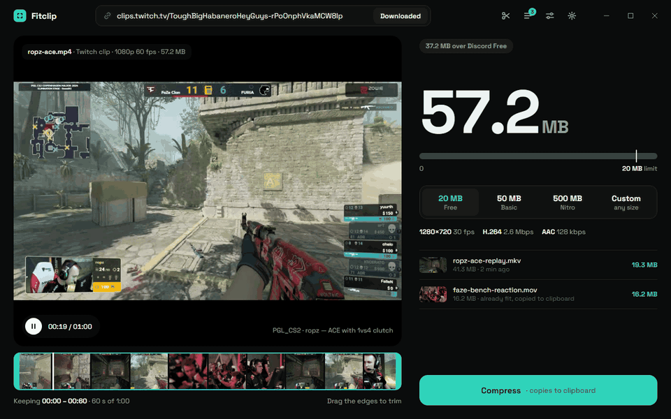
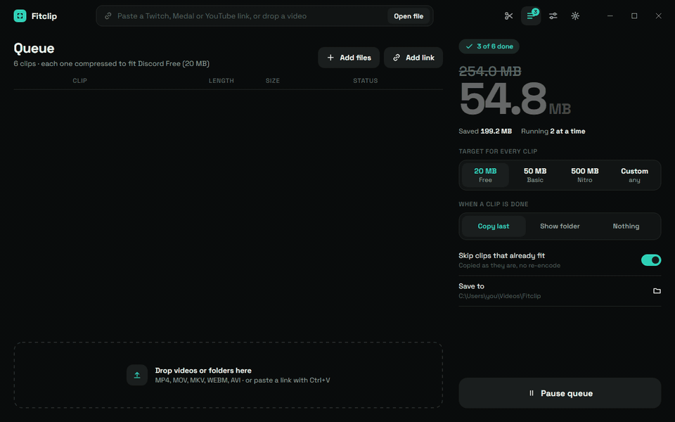
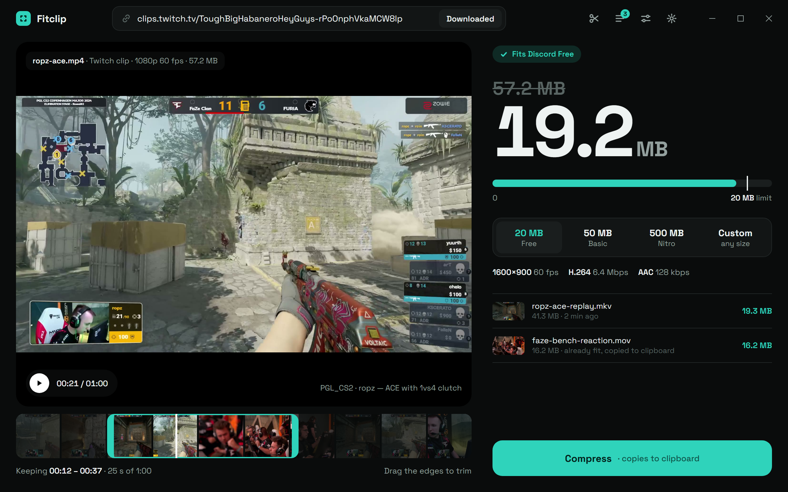
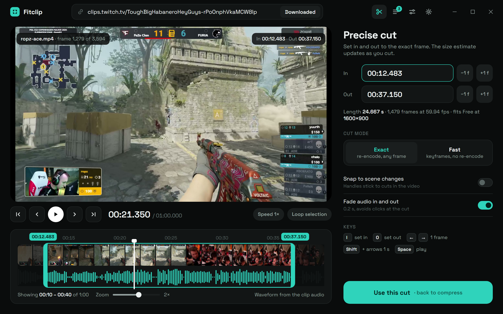
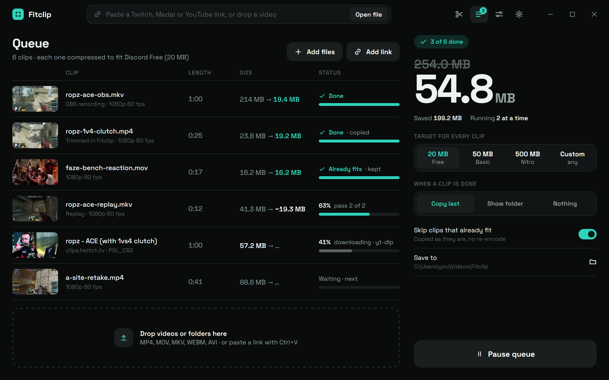
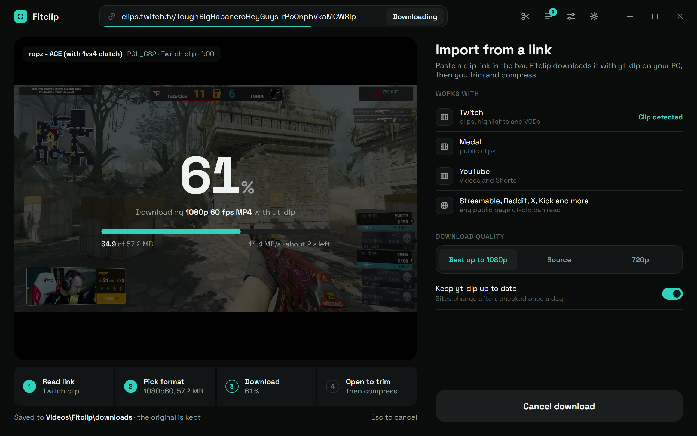
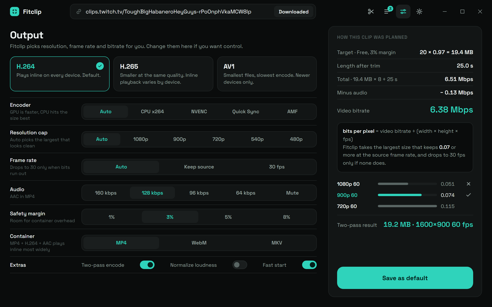
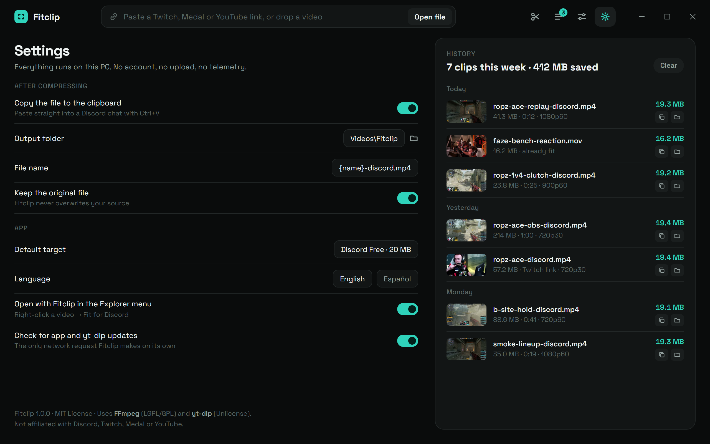
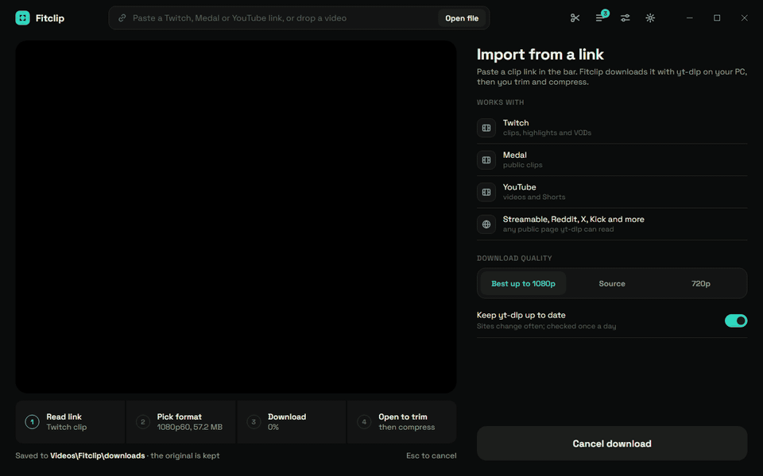

<p align="center"><a href="README.md">English</a> · <a href="README.es.md">Español</a> · <b>العربية</b> · <a href="README.hi.md">हिन्दी</a> · <a href="README.zh-CN.md">简体中文</a></p>

<div dir="rtl">

<div align="center">

<a href="https://github.com/DirectorEliminate/fitclip/releases/latest">
  
</a>

<h1>Fitclip — ضاغط فيديو مجاني لـ Discord على Windows و macOS و Linux</h1>

<p>
Fitclip ضاغط فيديو مجاني ومفتوح المصدر لـ Discord يعمل على Windows و macOS و Linux، يقصّ أي فيديو أو مقطع Twitch ويضغطه على جهازك أنت ليناسب حد الرفع في Discord: 20 MB للحساب المجاني، أو 50 MB مع Nitro Basic، أو 500 MB مع Nitro.<br>
<b>يدخل بحجم 57.2 MB ويخرج بحجم 19.2 MB.</b> أفلت ملفًا أو الصق رابط <b>مقطع Twitch</b> أو Medal أو YouTube، واسحب المقبضين لقص المقطع، واضغط Compress، ثم الصق النتيجة في Discord.<br>
بلا رفع للملفات، بلا علامة مائية، بلا حساب، وبلا حد لحجم الملف.
</p>

<p>
<a href="https://github.com/DirectorEliminate/fitclip/releases/latest"></a>
<a href="https://github.com/DirectorEliminate/fitclip/stargazers"></a>
<a href="LICENSE"></a>

<a href="https://github.com/DISCORD_INVITE"></a>
</p>

<p>
<a href="https://github.com/DirectorEliminate/fitclip/releases/latest/download/fitclip.zip"></a>
<a href="https://github.com/DirectorEliminate/fitclip/releases/latest/download/fitclip.zip"></a>
<a href="https://github.com/DirectorEliminate/fitclip/releases/latest/download/fitclip.zip"></a>
</p>

<p>
<a href="https://github.com/DirectorEliminate/fitclip/releases/latest">الإصدارات</a> ·
<a href="#how-fitclip-picks-the-bitrate">الحسابات</a> ·
<a href="#features">الميزات</a> ·
<a href="#download">التنزيل</a> ·
<a href="#faq">الأسئلة الشائعة</a>
</p>



</div>

<table>
<tr><th></th><th align="left">قبل</th><th align="left">بعد Fitclip</th></tr>
<tr><td><b>الملف</b></td><td><code>ropz-ace.mp4</code>، مقطع من Twitch</td><td><code>ropz-ace-discord.mp4</code>، موجود مسبقًا في حافظتك</td></tr>
<tr><td><b>الحجم</b></td><td>57.2 MB</td><td><b>19.2 MB</b></td></tr>
<tr><td><b>المدة</b></td><td>1:00</td><td>0:25، لحظة الـ clutch بنتيجة 1v4 فقط</td></tr>
<tr><td><b>الفيديو</b></td><td>1920×1080، 60 fps، 7.9 Mbps H.264</td><td>1600×900، 60 fps، 6.4 Mbps H.264</td></tr>
<tr><td><b>الصوت</b></td><td>AAC 128 kbps</td><td>AAC 128 kbps</td></tr>
<tr><td><b>Discord المجاني (20 MB)</b></td><td>أكبر من أن يُرسَل</td><td>يناسب الحد، مع 0.8 MB متبقية</td></tr>
</table>

## نظرة سريعة

| | |
|---|---|
| **ما هو** | تطبيق سطح مكتب يقصّ مقاطع الفيديو ويضغطها لتناسب حد الرفع لكل ملف في Discord |
| **السعر والرخصة** | مجاني ومفتوح المصدر بموجب رخصة MIT. بلا علامة مائية، بلا إعلانات، بلا حساب، وبلا خطة مدفوعة |
| **الأنظمة** | Windows 10 / 11 (x64)، و macOS 12+ (Apple Silicon و Intel)، و Linux (x64، بصيغتي AppImage و .deb) |
| **يعمل دون اتصال** | نعم. يجري الضغط محليًا عبر FFmpeg ولا يُرفع الفيديو أبدًا؛ الاستخدام الوحيد للشبكة هو الروابط التي تلصقها وفحص يومي للتحديثات يمكنك إيقافه |
| **إعدادات Discord الجاهزة** | 20 MB للحساب المجاني، و50 MB لـ Nitro Basic، و500 MB لـ Nitro، أو أي حجم مخصص (الحدود وقت كتابة هذا النص، نوفمبر 2026) |
| **أهم الميزات** | ترميز بتمريرتين يستهدف حجمًا أقل من الحد بنسبة 3% · دقة ومعدل إطارات تلقائيان · شريط قص وقص دقيق على مستوى الإطار · روابط Twitch و Medal و YouTube · نسخ النتيجة إلى الحافظة · قائمة انتظار للمعالجة الجماعية · H.264 و H.265 و AV1 |
| **الأدوات المضمّنة** | FFmpeg (LGPL/GPL) و yt-dlp (Unlicense)؛ لا حاجة لتثبيت أي شيء آخر |
| **بديل لـ** | أدوات ضغط الفيديو عبر الإنترنت، و HandBrake عندما يكون كل ما تحتاجه هو «اجعل هذا الملف يتسع في X MB» |
| **الإصدار** | 1.0.0 |

## رابط واحد يدخل، وملف واحد يخرج

<table>
<tr>
<td width="31%" valign="top"><b>1 · أحضر الفيديو</b><br>أفلت ملفًا على النافذة، أو اضغط <kbd>Ctrl</kbd>+<kbd>V</kbd> بعد نسخ رابط، أو انقر بزر الفأرة الأيمن على فيديو في Explorer واختر <i>Fit for Discord</i>. يتولى <a href="https://github.com/yt-dlp/yt-dlp">yt-dlp</a> تنزيل الروابط على جهازك.</td>
<td width="3%" align="center">←</td>
<td width="31%" valign="top"><b>2 · احتفظ بالجزء الجيد</b><br>اسحب المقبضين الفيروزيين على شريط الصور المصغّرة. يتحدّث تقدير الحجم والجودة أثناء السحب، لأن المقطع الأقصر يحصل على عدد أكبر من البتات في كل ثانية.</td>
<td width="3%" align="center">←</td>
<td width="31%" valign="top"><b>3 · اضغط والصق</b><br>اختر <i>20 MB Free</i> أو <i>50 MB Basic</i> أو <i>500 MB Nitro</i> أو حجمًا مخصصًا. يرمّز Fitclip الفيديو بتمريرتين، وينسخ الملف إلى الحافظة، ثم تلصقه أنت في دردشة Discord.</td>
</tr>
</table>

<a id="how-fitclip-picks-the-bitrate"></a>
## كيف يختار Fitclip معدل البت

حجم الملف يساوي معدل البت مضروبًا في مدته. لذلك بدلًا من التخمين باستخدام منزلق للجودة، يعمل Fitclip بشكل عكسي انطلاقًا من الحجم الذي تحتاجه:

```text
target size   = upload limit × (1 − safety margin)            margin = 3 % for container overhead
total bitrate = target size × 8 ÷ length in seconds
video bitrate = total bitrate − audio bitrate
bits/pixel    = video bitrate ÷ (width × height × fps)          keep it ≥ 0.07 for clean game footage
```

ثم يختار **أعلى دقة** يبقى فيها عدد البتات لكل بكسل عند 0.07 أو أكثر بمعدل إطارات المصدر (1080p → 900p → 720p). وإن لم تحقق ذلك أي دقة، يخفض معدل الإطارات إلى النصف ويحاول مجددًا، ثم ينزل إلى 540p و480p و360p. ويجري الترميز **بتمريرتين**: تقيس التمريرة الأولى مدى صعوبة كل مشهد، وتنفق الثانية البتات حيث تدور الأحداث، فيستقر الحجم تحت الهدف مباشرة بدلًا من تجاوزه.

**مثال محلول: المقطع الظاهر في لقطات الشاشة** (يُقصد بـ MB هنا 1,048,576 بايت، وهي الطريقة التي يعرض بها Windows و Discord أحجام الملفات)

| الخطوة | الحساب | النتيجة |
|---|---|---|
| الهدف | 20 MB × 0.97 | **19.4 MB** = 20,342,374 بايت |
| المدة بعد القص | 00:12 → 00:37 | **25.0 ثانية** |
| معدل البت الإجمالي | 20,342,374 × 8 ÷ 25 | **6.51 Mbps** |
| معدل بت الفيديو | 6.51 − 0.128 (AAC) | **6.38 Mbps** |
| 1080p بمعدل 59.94 fps | 6,381,560 ÷ (1920 × 1080 × 59.94) | 0.051 ✗ بتات غير كافية |
| **900p بمعدل 59.94 fps** | 6,381,560 ÷ (1600 × 900 × 59.94) | **0.074 ✓ الدقة المختارة** |
| نتيجة H.264 بتمريرتين | | **19.2 MB**، 1600×900، 60 fps |

أما المقطع نفسه **دون قص** (60 ثانية) فيحصل على 2.59 Mbps للفيديو: دقة 720p بمعدل 60 fps لا تصل إلا إلى 0.047، لذا يُبقي Fitclip على 720p وينزل إلى 30 fps (0.094). القص حتى اللحظة المهمة هو أرخص ترقية للجودة على الإطلاق. وتعرض شاشة الإخراج هذه الخطة لكل ملف، فلا شيء يجري في الخفاء.

<a id="features"></a>
## الميزات

<table>
<tr>
<td width="33%" valign="top"><b>🎯 يصيب الحجم المطلوب</b><br>ترميز بتمريرتين يستهدف حجمًا أقل من الحد بنسبة 3%. لا مزيد من دوامة «أعد المحاولة بجودة أقل».</td>
<td width="33%" valign="top"><b>✂️ قص على الإطارات الفعلية</b><br>شريط صور مصغّرة بمقبضين فيروزيين، إضافة إلى شاشة قص دقيق مع التنقل إطارًا بإطار وعرض الموجة الصوتية.</td>
<td width="33%" valign="top"><b>🔗 روابط المقاطع</b><br>الصق رابطًا من Twitch أو Medal أو YouTube. ينزّله yt-dlp محليًا، ثم يُفتح جاهزًا للقص.</td>
</tr>
<tr>
<td valign="top"><b>📋 منسوخ إلى الحافظة</b><br>الملف النهائي في حافظتك. اضغط <kbd>Ctrl</kbd>+<kbd>V</kbd> في Discord وسيبدأ الرفع.</td>
<td valign="top"><b>🧮 دقة ومعدل إطارات تلقائيان</b><br>يختار 1080p أو 900p أو 720p، و60 أو 30 fps، وفق الحسابات أعلاه. ويمكنك تعديل أي شيء من شاشة الإخراج (Output).</td>
<td valign="top"><b>📦 قائمة انتظار جماعية</b><br>أفلت مجلدًا من المقاطع. يُضبط كل مقطع على الهدف نفسه؛ والملفات التي تناسب الحد أصلًا تُتخطّى وتبقى كما هي.</td>
</tr>
<tr>
<td valign="top"><b>🎞️ H.264 و H.265 و AV1</b><br>H.264 افتراضيًا للتشغيل المباشر في كل مكان؛ و H.265 و AV1 لملفات أصغر. ومُرمِّزات GPU عند توفرها.</td>
<td valign="top"><b>🔒 دون اتصال وبخصوصية تامة</b><br>لا يغادر الفيديو جهازك أبدًا. بلا حساب، بلا قياس عن بُعد (telemetry)، بلا علامة مائية، وبلا حد لحجم الملف.</td>
<td valign="top"><b>🖱️ السحب والإفلات في كل مكان</b><br>على النافذة، أو على قائمة الانتظار، أو بالنقر بزر الفأرة الأيمن في Explorer واختيار <i>Fit for Discord</i>.</td>
</tr>
</table>

<p align="center">

</p>

## لقطات الشاشة

| | |
|---|---|
| <br><sub><b>الضغط.</b> حجم المصدر مشطوبًا، وحجم النتيجة، ومؤشر يقارنها بالحد، ومحدد الخطة.</sub> | <br><sub><b>القص الدقيق.</b> بداية ونهاية بدقة الإطار، قص دقيق أو عند الإطارات المفتاحية، وتلاشٍ تدريجي للصوت.</sub> |
| <br><sub><b>قائمة الانتظار.</b> مقاطع كثيرة، وهدف واحد، ومقطعان في كل مرة.</sub> | <br><sub><b>استيراد الروابط.</b> ينزّل yt-dlp المقطع على جهازك.</sub> |
| <br><sub><b>الإخراج.</b> الترميز، والمُرمِّز، والحدود القصوى، وخطة هذا المقطع.</sub> | <br><sub><b>الإعدادات والسجل.</b> كل مقطع ضغطته، جاهز للنسخ مجددًا.</sub> |

## المصادر المدعومة



| المصدر | ما الذي يعمل | طريقة الإدخال |
|---|---|---|
| **ملفات الفيديو** | MP4 و MOV و MKV و WEBM و AVI و M4V و FLV و TS وأي صيغة أخرى يستطيع FFmpeg قراءتها | السحب والإفلات، أو *Open file*، أو قائمة Explorer، أو لصق ملف |
| **تسجيلات الألعاب** | OBS، و NVIDIA ShadowPlay / NVIDIA App، و Xbox Game Bar، و AMD ReLive، وتسجيلات الألعاب المُصدَّرة من Steam | أفلت الملف أو مجلدًا كاملًا في قائمة الانتظار |
| **Twitch** | المقاطع العامة، وأبرز اللحظات (highlights)، والبثوث المسجّلة (VODs) | الصق الرابط، وسينزّله yt-dlp |
| **Medal** | المقاطع العامة | الصق الرابط |
| **YouTube** | الفيديوهات و Shorts | الصق الرابط |
| **مواقع أخرى** | Streamable و Reddit و X و Kick وغيرها من المواقع العامة التي يدعمها yt-dlp | الصق الرابط |

لا تنزّل إلا الفيديوهات التي صنعتها أو لديك إذن باستخدامها. الفيديوهات الخاصة، والمخصصة للمشتركين فقط، والمحمية بتقنية DRM غير مدعومة.

## حدود الرفع في Discord

تتبع إعدادات Fitclip الجاهزة حدود الملف الواحد التي تعلنها Discord. **وقت كتابة هذا النص (نوفمبر 2026):**

| من يرفع الملف | الحد لكل ملف | إعداد Fitclip الجاهز |
|---|---|---|
| حساب مجاني | **20 MB** (رُفع من 10 MB في 13 أغسطس 2026) | **20 MB Free** |
| Nitro Basic | 50 MB | 50 MB Basic |
| Nitro | 500 MB | 500 MB Nitro |
| أي عضو في خادم بمستوى Boost Level 2 | 50 MB داخل ذلك الخادم | Custom → 50 MB |
| أي عضو في خادم بمستوى Boost Level 3 | 100 MB داخل ذلك الخادم | Custom → 100 MB |

غيّرت Discord هذه الأرقام عدة مرات (8 MB → 25 MB → 10 MB → 20 MB). تُحفظ الإعدادات الجاهزة في ملف صغير يُحدَّث مع التطبيق، ويقبل خيار **Custom** أي حجم، بما في ذلك 10 MB إن كنت لا تزال تحتاج إلى الحد القديم أو كنت ترسل الملف إلى مكان آخر.

## Fitclip مقابل أدوات ضغط الفيديو عبر الإنترنت

أدوات الضغط عبر الإنترنت مفيدة، لكن الفيديو يجب أن يُرفع أولًا إلى خادم شخص آخر. إليك مقارنة منصفة، **وقت كتابة هذا النص** (الخطط المجانية تتفاوت وتتغير، فتحقّق منها قبل الاعتماد عليها):

| | **Fitclip** | أداة ضغط مجانية نموذجية عبر الإنترنت | HandBrake |
|---|:---:|:---:|:---:|
| السعر | مجاني، MIT | خطة مجانية وخطط مدفوعة | مجاني، GPL |
| هل يُرفع الفيديو | **لا، يبقى على جهازك** | نعم | لا |
| العلامة المائية | **أبدًا** | في بعض الخطط المجانية | أبدًا |
| حد لحجم ملف الإدخال | **لا يوجد** | غالبًا محدود في الخطط المجانية | لا يوجد |
| هدف «اجعله X MB» | **نعم، بتمريرتين** | عادةً | معدل بت متوسط فقط، والحساب عليك |
| إعدادات Discord الجاهزة (20 / 50 / 500 MB) | **نعم** | بعضها | لا |
| القص قبل الضغط | **نعم** | بعضها | نعم |
| التنزيل من روابط Twitch / Medal / YouTube | **نعم (yt-dlp)** | نادرًا | لا |
| نسخ النتيجة إلى الحافظة | **نعم** | لا | لا |
| يعمل دون اتصال | **نعم** | لا | نعم |

إن كنت تبحث عن **بديل مجاني لأدوات ضغط فيديو Discord عبر الإنترنت** لا يرفع مقاطعك، فهذه هي الفكرة كلها.

<a id="download"></a>
## التنزيل

| النظام | الحزمة | ملاحظات |
|---|---|---|
| **Windows 10 / 11** (x64) | [`fitclip.zip`](https://github.com/DirectorEliminate/fitclip/releases/latest/download/fitclip.zip) · [نسخة محمولة `.zip`](https://github.com/DirectorEliminate/fitclip/releases/latest/download/fitclip.zip) | `winget install Fitclip.Fitclip` · `scoop install fitclip` |
| **macOS 12+** (Apple Silicon و Intel) | [`Fitclip-1.0.0-universal.dmg`](https://github.com/DirectorEliminate/fitclip/releases/latest/download/fitclip.zip) | `brew install --cask fitclip` |
| **Linux** (x64) | [`AppImage`](https://github.com/DirectorEliminate/fitclip/releases/latest/download/fitclip.zip) · [`.deb`](https://github.com/DirectorEliminate/fitclip/releases/latest/download/fitclip.zip) | Flathub: `io.github.DirectorEliminate.Fitclip` |

يأتي FFmpeg و yt-dlp مضمّنين؛ لا حاجة لتثبيت أي شيء آخر. **المتطلبات:** نظام تشغيل 64-بت، وذاكرة RAM بسعة 4 GB، ونحو 250 MB من مساحة القرص. وجود GPU يدعم NVIDIA NVENC أو Intel Quick Sync أو AMD AMF أو Apple VideoToolbox يُسرّع الترميز، لكنه اختياري. تجد قيم التحقق (checksums) في `SHA256SUMS.txt` مع كل إصدار.

## حالات الاستخدام

- **أرسل مقطع Twitch على Discord.** الصق رابط `clips.twitch.tv`، ثم قص واضغط والصق. المقطع الظاهر في لقطات الشاشة ينخفض من 57.2 MB إلى 19.2 MB.
- **صغّر تسجيل OBS بما يكفي لـ Discord.** تسجيل مدته دقيقة واحدة بدقة 1080p60 يبلغ غالبًا 150–250 MB. يقصّه Fitclip ويجعله يتسع في 20 MB، أو 50 MB مع Nitro Basic.
- **صغّر فيديو الهاتف لـ Discord.** تُحوَّل ملفات iPhone بصيغة `.mov` (HEVC) إلى H.264 MP4 لتُشغَّل مباشرة في المحادثة لدى الجميع.
- **اضغط فيديوهات Discord بالجملة.** أفلت مجلد اللقطات المميزة بالكامل في قائمة الانتظار قبل نشر ملخص المباراة.
- **مستخدمو Nitro.** اختر 50 MB أو 500 MB واحصل على جودة أعلى من المقطع نفسه بدلًا من الضغط الشديد الذي تفرضه الخطة المجانية.

<a id="faq"></a>
## الأسئلة الشائعة

<details>
<summary><b>كيف أضغط فيديو لـ Discord؟</b></summary>

افتح Fitclip، وأفلت الفيديو على النافذة (أو الصق رابطًا)، واسحب المقبضين للإبقاء على الجزء الذي تريده، واترك الخطة على **20 MB Free** (أو اختر خطة Nitro الخاصة بك)، ثم اضغط **Compress**. يُنسخ ملف MP4 النهائي إلى حافظتك؛ انقر على مربع الرسائل في Discord واضغط <kbd>Ctrl</kbd>+<kbd>V</kbd>.
</details>

<details>
<summary><b>ما حد حجم الملفات في Discord؟ هل ما زال 10 MB؟</b></summary>

لا. وقت كتابة هذا النص، يمكن للحسابات المجانية رفع ملفات يصل حجمها إلى **20 MB**. خفّضت Discord الحد المجاني من 25 MB إلى 10 MB في 2024، ثم رفعته إلى 20 MB في 13 أغسطس 2026. يسمح Nitro Basic بـ 50 MB و Nitro بـ 500 MB؛ أما الخوادم بمستوى Boost Level 2 و 3 فتسمح بـ 50 MB و 100 MB لكل من فيها. وإن احتجت لسبب ما إلى حجم **Discord 10 MB** القديم، فاختر *Custom* واكتب 10.
</details>

<details>
<summary><b>كيف أضغط فيديو دون فقدان الجودة؟</b></summary>

بعض الفقد لا مفر منه عندما يصغر الملف كثيرًا، لكن يمكنك أن تجعله غير ملحوظ: **قص أولًا** (نصف المدة يعني ضعف معدل البت)، ودع Fitclip يختار الدقة ليحصل كل بكسل على بتات كافية، وأبقِ الترميز بتمريرتين مفعّلًا، واستخدم H.265 أو AV1 إن كانت أجهزة أصدقائك تشغّلهما. بالنسبة إلى المقطع أعلاه، تبدو 25 ثانية بدقة 900p60 ومعدل 6.4 Mbps قريبة جدًا من المصدر بدقة 1080p60 ومعدل 7.9 Mbps.
</details>

<details>
<summary><b>كيف أرسل مقطع Twitch إلى Discord؟</b></summary>

الصق رابط `clips.twitch.tv/...` في الشريط العلوي في Fitclip: ينزّله yt-dlp بدقة 1080p، ثم تقصّه أنت، ويجعله Fitclip يتسع في الحد، ثم تلصق الملف في Discord. نشر الرابط وحده يفي بالغرض أيضًا، لكن الناس سيشاهدونه حينها على Twitch. لا تفعل ذلك إلا مع المقاطع التي يحق لك مشاركتها.
</details>

<details>
<summary><b>ما أقصى مدة للفيديو كي يتسع في 20 MB؟</b></summary>

نحو 25–30 ثانية تحافظ على 1080p أو 900p بمعدل 60 fps في لقطات الألعاب، ونحو دقيقة تمنحك 720p بمعدل 30 fps، وقرابة 5 دقائق هي أطول مدة تبقى بمظهر نظيف بدقة 360p. وفيما يتجاوز ذلك، ينبّهك Fitclip ويقترح القص أو خطة أكبر.
</details>

<details>
<summary><b>لماذا يأتي حجم ملفي أقل من الحد بقليل، وليس 20 MB بالضبط؟</b></summary>

يستهدف Fitclip حجمًا أقل من الحد بنسبة 3% ليترك مساحة لحاوية MP4 ولأخطاء التحكم في معدل البت الصغيرة. فالملف الذي يتجاوز الحد بمقدار 0.1 MB يرفضه Discord، أما الذي يقل عنه بمقدار 0.6 MB فلا. ويمكنك ضبط الهامش على 1% من شاشة الإخراج (Output).
</details>

<details>
<summary><b>هل يرفع Fitclip فيديوهاتي إلى أي مكان؟</b></summary>

لا. يجري الضغط محليًا عبر FFmpeg. طلبات الشبكة الوحيدة هي التنزيلات التي تبدأها أنت بلصق رابط، وفحص للتحديثات مرة واحدة يوميًا للتطبيق و yt-dlp، ويمكنك إيقافه.
</details>

<details>
<summary><b>لماذا لا يُشغَّل فيديو H.265 أو AV1 مباشرة داخل Discord؟</b></summary>

يعتمد التشغيل المباشر على جهاز المشاهد وتطبيقه. الجمع بين H.264 و AAC في حاوية MP4 هو الخيار الأضمن، ولهذا هو الافتراضي. استخدم H.265 أو AV1 عندما تعرف من سيشاهد، أو عندما يكون توفير الحجم أهم من المعاينة المباشرة.
</details>

<details>
<summary><b>هل يمكنني ضغط عدة فيديوهات دفعة واحدة؟</b></summary>

نعم. افتح قائمة الانتظار، وأفلت الملفات أو مجلدًا، واختر هدفًا واحدًا لها جميعًا، وسيعالج Fitclip مقطعين في كل مرة. أما المقاطع التي تناسب الحد أصلًا فتُنسخ كما هي دون إعادة ترميز.
</details>

<details>
<summary><b>هل Fitclip مجاني؟ هل توجد علامة مائية؟</b></summary>

نعم، هو مجاني ومفتوح المصدر بموجب رخصة MIT، ولا توجد علامة مائية. بلا إعلانات، بلا حساب، وبلا خطة مدفوعة. ويتضمن FFmpeg (LGPL/GPL) و yt-dlp (Unlicense)؛ راجع قسم الشكر والتقدير أدناه.
</details>

<details>
<summary><b>هل Fitclip من صنع Discord أو Twitch؟</b></summary>

لا. إنه مشروع مستقل مفتوح المصدر، وليس تابعًا لـ Discord أو Twitch أو Medal أو YouTube.
</details>

## خارطة الطريق

- [x] جعل الملف يتسع في 20 / 50 / 500 MB أو أي حجم مخصص، بتمريرتين
- [x] شريط القص وشاشة القص الدقيق على مستوى الإطار
- [x] روابط Twitch و Medal و YouTube عبر yt-dlp
- [x] قائمة انتظار جماعية مع تخطّي الملفات التي تناسب الحد أصلًا
- [x] H.264 و H.265 و AV1 ومُرمِّزات GPU
- [ ] اقتصاص بنسبة 9:16 لمقاطع Shorts والهواتف
- [ ] مجلد مراقَب: ضبط كل إعادة عرض (replay) جديدة من OBS تلقائيًا
- [ ] إخراج بصيغة GIF و WebP المتحركة لمقاطع ردود الفعل
- [ ] دمج عدة مقاطع في مقطع واحد قبل الضغط
- [ ] ترجمة مدمجة في الصورة من ملف `.srt`
- [ ] مزيد من اللغات (البرتغالية، والألمانية، والفرنسية)

الأفكار والتصويت: [النقاشات (Discussions)](https://github.com/DirectorEliminate/fitclip/discussions/categories/ideas).

## بُني باستخدام

<p>


</p>

**شكر وتقدير.** يتولى [FFmpeg](https://ffmpeg.org/) معالجة الفيديو (LGPL 2.1+، مع مكونات GPL مثل x264/x265 في النسخة المضمّنة؛ وتُرفق الشيفرة المصدرية ونصوص الرخص مع كل إصدار). ويتولى [yt-dlp](https://github.com/yt-dlp/yt-dlp) تنزيل الروابط (Unlicense). شكرًا للمشروعين كليهما.

## المساهمة

نرحّب بتقارير الأخطاء والإعدادات الجاهزة والترجمات والشيفرة البرمجية. اقرأ [CONTRIBUTING.md](CONTRIBUTING.md)؛ أما المشكلات الأمنية فمكانها [SECURITY.md](SECURITY.md).

<a href="https://github.com/DirectorEliminate/fitclip/graphs/contributors"></a>

<a href="https://star-history.com/#DirectorEliminate/fitclip&Date">
  
</a>

## الرخصة وإخلاء المسؤولية

يُصدَر Fitclip بموجب [رخصة MIT](LICENSE). ويحتفظ FFmpeg و yt-dlp المضمّنان برخصهما الخاصة.

Fitclip مشروع مستقل، وهو **غير تابع لـ Discord Inc. أو Twitch Interactive, Inc. أو Medal أو Google LLC (YouTube)، ولا تؤيده أو ترعاه أيٌّ منها**. إن Discord و Nitro و Twitch و Medal و YouTube علامات تجارية مملوكة لأصحابها، وتُذكر هنا فقط لوصف التوافق. المقطع الظاهر في لقطات الشاشة وملفات GIF مأخوذ من بث PGL CS2 Major على قناة PGL_CS2 في Twitch (لعبة Counter-Strike 2 من إنتاج Valve)، ويُستخدم فقط لتوضيح عمل التطبيق. لا تنزّل ولا تشارك إلا الفيديوهات التي يحق لك استخدامها.

---

<div align="center">

إن أنقذك Fitclip من رسالة «الملف كبير جدًا» (file too large)، فـ ⭐ **ضع نجمة للمستودع** ليجده الآخرون.

<sub>كلمات مفتاحية: ضاغط فيديو Discord · ضغط فيديو لـ Discord · حد 10 ميجا و20 ميجا في ديسكورد · تصغير حجم الفيديو لديسكورد · إرسال مقطع Twitch على Discord · تقليل حجم ملف الفيديو · ضاغط فيديو مجاني بدون علامة مائية · ضاغط فيديو بدون إنترنت لـ Windows و macOS و Linux · discord video compressor · compress video for discord</sub>

</div>

</div>
