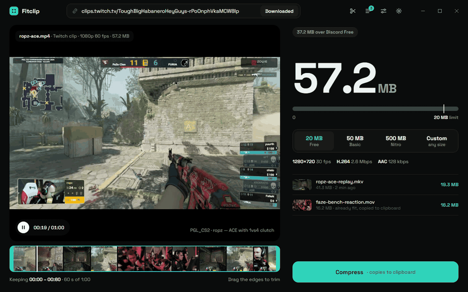
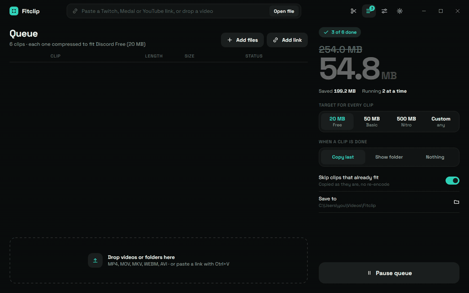
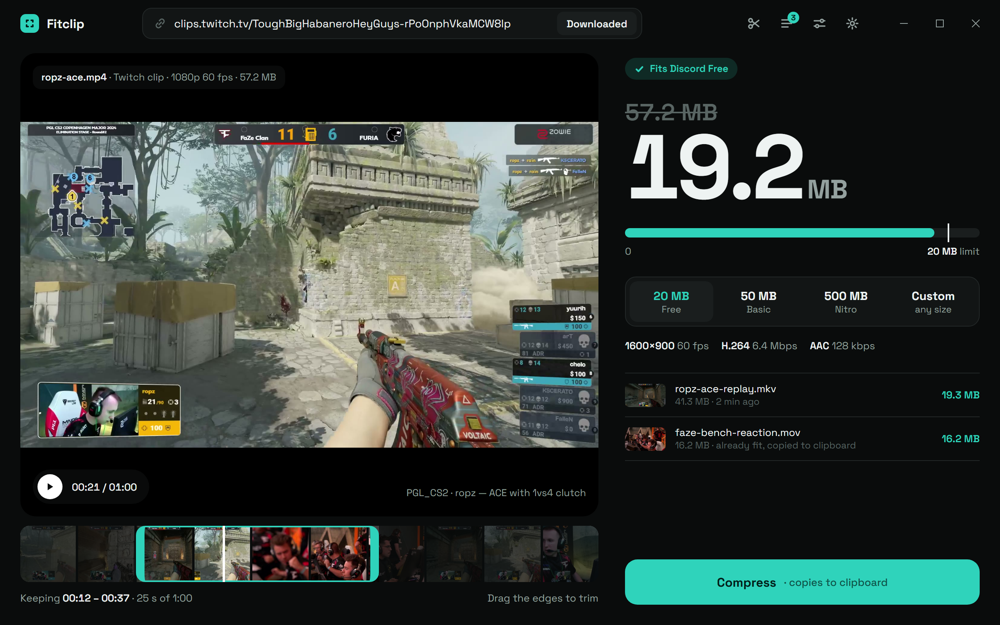
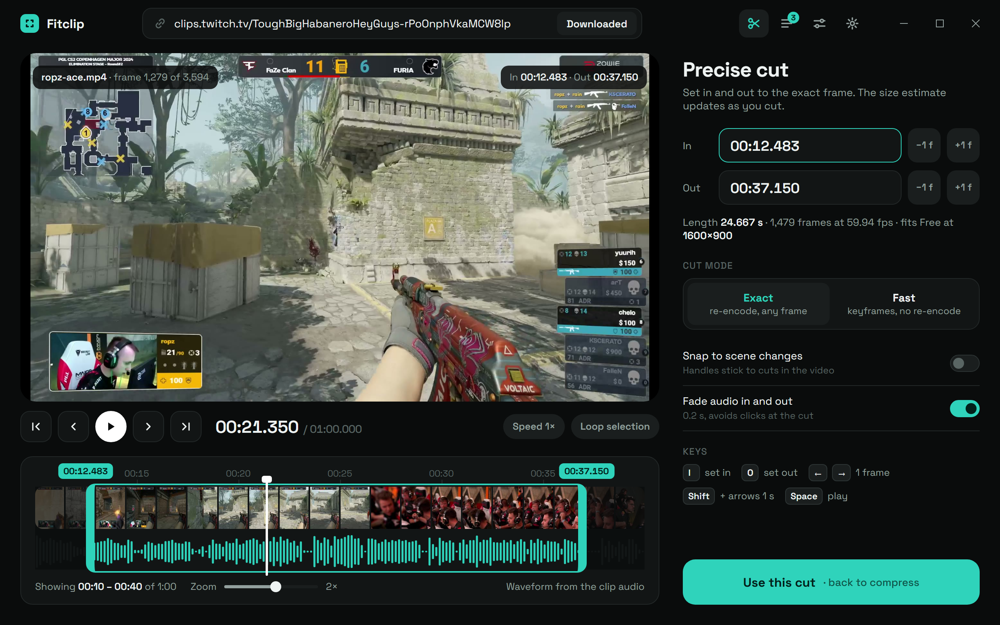
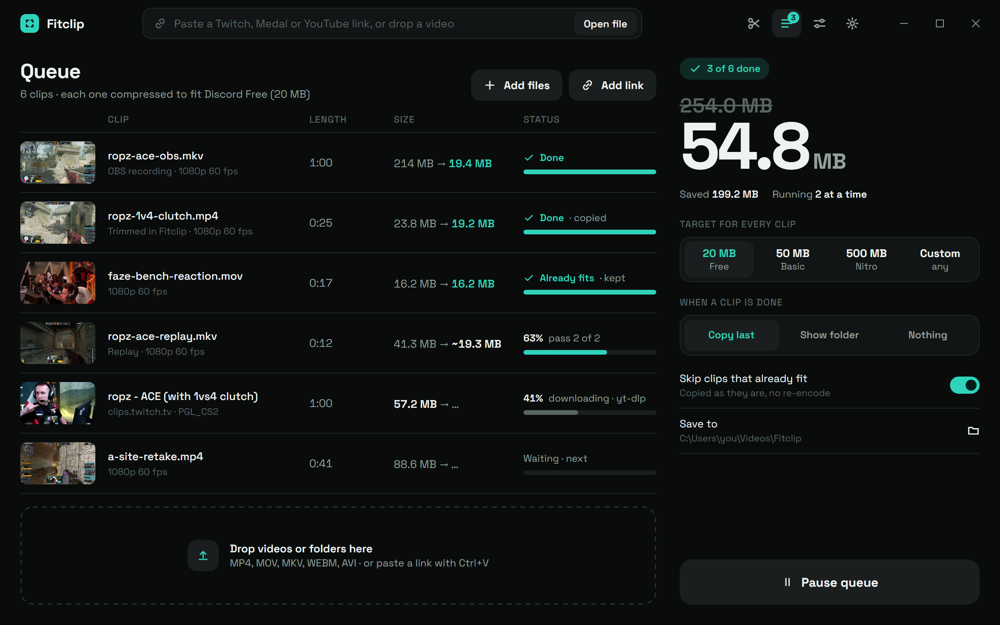
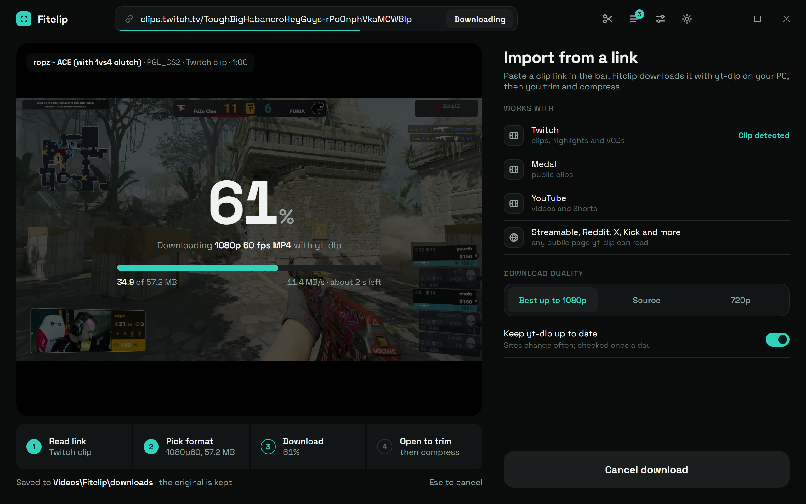
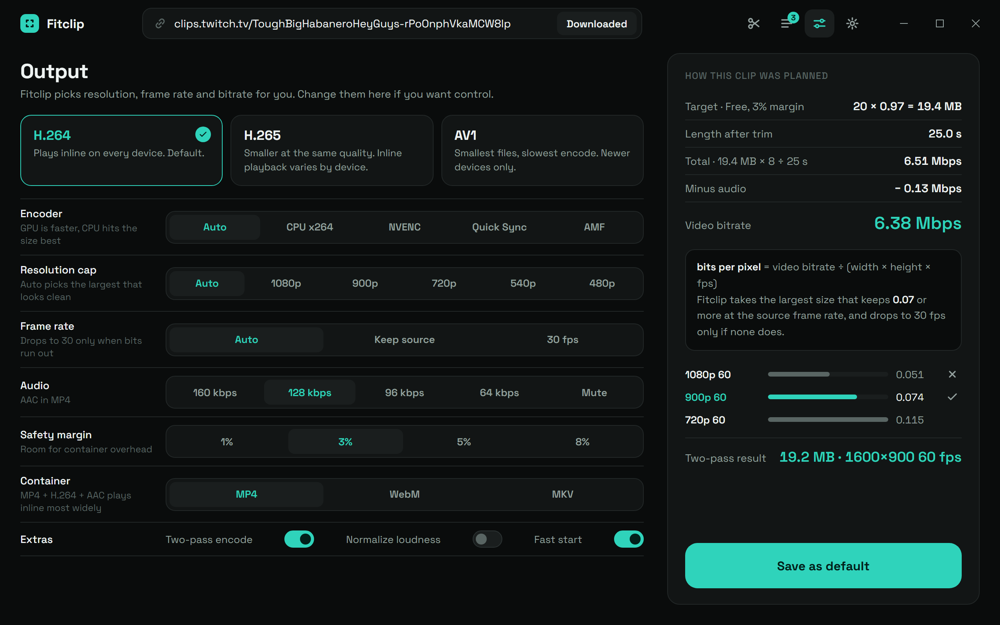
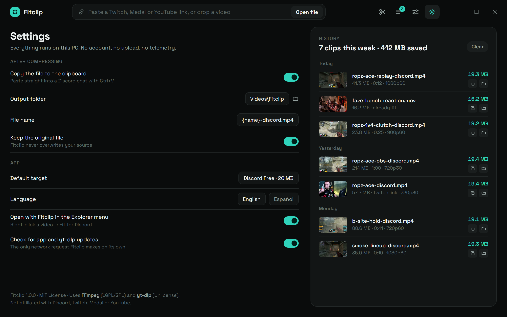
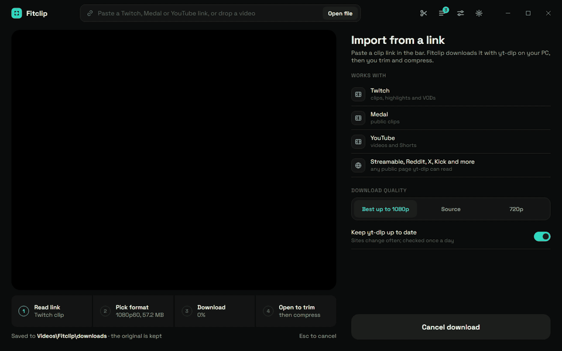

<div align="center">

<a href="https://github.com/DirectorEliminate/fitclip/releases/latest">
  
</a>

<h1>Fitclip — Compresor de video para Discord, gratis, para Windows, macOS y Linux</h1>

<p>
Fitclip es un compresor de video para Discord gratis y de código abierto para Windows, macOS y Linux que recorta y comprime cualquier video o clip de Twitch en tu propio PC para que entre en el límite de subida de Discord: 20 MB gratis, 50 MB con Nitro Basic o 500 MB con Nitro.<br>
<b>Entran 57.2 MB, salen 19.2 MB.</b> Arrastra un archivo o pega un enlace de un <b>clip de Twitch</b>, Medal o YouTube, mueve los tiradores para recortar, pulsa Comprimir y pega el resultado en Discord.<br>
Sin subir nada, sin marca de agua, sin cuenta y sin límite de tamaño de entrada.
</p>

<p>
<a href="https://github.com/DirectorEliminate/fitclip/releases/latest"></a>
<a href="https://github.com/DirectorEliminate/fitclip/releases"></a>
<a href="https://github.com/DirectorEliminate/fitclip/stargazers"></a>
<a href="LICENSE"></a>

<a href="https://github.com/DISCORD_INVITE"></a>
</p>

<p>
<a href="https://github.com/DirectorEliminate/fitclip/releases/latest/download/fitclip.zip"></a>
<a href="https://github.com/DirectorEliminate/fitclip/releases/latest/download/fitclip.zip"></a>
<a href="https://github.com/DirectorEliminate/fitclip/releases/latest/download/fitclip.zip"></a>
</p>

<p>
<a href="README.md">English</a> · <b>Español</b> · <a href="README.ar.md">العربية</a> · <a href="README.hi.md">हिन्दी</a> · <a href="README.zh-CN.md">简体中文</a> &nbsp;|&nbsp;
<a href="https://github.com/DirectorEliminate/fitclip/releases/latest">Descargas</a> ·
<a href="#cómo-elige-fitclip-el-bitrate">Las cuentas</a> ·
<a href="#funciones">Funciones</a> ·
<a href="#descarga">Descarga</a> ·
<a href="#preguntas-frecuentes">Preguntas</a>
</p>



</div>

<table>
<tr><th></th><th align="left">Antes</th><th align="left">Después de Fitclip</th></tr>
<tr><td><b>Archivo</b></td><td><code>ropz-ace.mp4</code>, un clip de Twitch</td><td><code>ropz-ace-discord.mp4</code>, ya copiado al portapapeles</td></tr>
<tr><td><b>Tamaño</b></td><td>57.2 MB</td><td><b>19.2 MB</b></td></tr>
<tr><td><b>Duración</b></td><td>1:00</td><td>0:25, solo el clutch 1v4</td></tr>
<tr><td><b>Video</b></td><td>1920×1080, 60 fps, 7.9 Mbps H.264</td><td>1600×900, 60 fps, 6.4 Mbps H.264</td></tr>
<tr><td><b>Audio</b></td><td>AAC 128 kbps</td><td>AAC 128 kbps</td></tr>
<tr><td><b>Discord gratis (20 MB)</b></td><td>Demasiado grande para enviarlo</td><td>Entra, y sobran 0.8 MB</td></tr>
</table>

## De un vistazo

| | |
|---|---|
| **Qué es** | Una app de escritorio que recorta y comprime videos para que entren en el límite de subida por archivo de Discord |
| **Precio y licencia** | Gratis, código abierto con licencia MIT. Sin marca de agua, sin anuncios, sin cuenta, sin plan de pago |
| **Plataformas** | Windows 10 / 11 (x64), macOS 12+ (Apple Silicon e Intel), Linux (x64, AppImage y .deb) |
| **Funciona sin conexión** | Sí. La compresión se hace en tu equipo con FFmpeg y tu video nunca se sube; solo se conecta para los enlaces que pegas y una comprobación diaria de actualizaciones que puedes desactivar |
| **Preajustes de Discord** | 20 MB gratis, 50 MB Nitro Basic, 500 MB Nitro o cualquier tamaño (límites al momento de escribir esto, noviembre de 2026) |
| **Funciones principales** | Codificación en dos pasadas 3 % por debajo del límite · resolución y fps automáticos · tira de recorte y corte exacto al cuadro · enlaces de Twitch, Medal y YouTube · resultado copiado al portapapeles · cola por lotes · H.264, H.265, AV1 |
| **Herramientas incluidas** | FFmpeg (LGPL/GPL) y yt-dlp (Unlicense); no hay que instalar nada más |
| **Alternativa a** | Los compresores de video en línea, y HandBrake cuando solo necesitas "que pese X MB" |
| **Versión** | 1.0.0 |

## Un enlace entra, un archivo sale

<table>
<tr>
<td width="31%" valign="top"><b>1 · Trae el video</b><br>Arrastra un archivo a la ventana, pulsa <kbd>Ctrl</kbd>+<kbd>V</kbd> con un enlace copiado o haz clic derecho sobre un video en el Explorador → <i>Ajustar para Discord</i>. Los enlaces los descarga <a href="https://github.com/yt-dlp/yt-dlp">yt-dlp</a> en tu PC.</td>
<td width="3%" align="center">→</td>
<td width="31%" valign="top"><b>2 · Quédate con lo bueno</b><br>Mueve los tiradores verde azulado sobre la tira de miniaturas. El tamaño y la calidad estimada se actualizan mientras arrastras, porque un clip más corto recibe más bits por segundo.</td>
<td width="3%" align="center">→</td>
<td width="31%" valign="top"><b>3 · Comprime y pega</b><br>Elige <i>20 MB gratis</i>, <i>50 MB Basic</i>, <i>500 MB Nitro</i> o un tamaño propio. Fitclip codifica en dos pasadas, copia el archivo al portapapeles y tú lo pegas en el chat de Discord.</td>
</tr>
</table>

## Cómo elige Fitclip el bitrate

El tamaño de un archivo es su bitrate multiplicado por su duración. Así que, en lugar de adivinar con un control de calidad, Fitclip calcula hacia atrás a partir del tamaño que necesitas:

```text
tamaño objetivo  = límite de subida × (1 − margen)              margen = 3 % para el contenedor
bitrate total    = tamaño objetivo × 8 ÷ duración en segundos
bitrate de video = bitrate total − bitrate de audio
bits por píxel   = bitrate de video ÷ (ancho × alto × fps)       mínimo 0.07 para que un juego se vea limpio
```

Luego elige la **resolución más grande** cuyos bits por píxel se mantengan en 0.07 o más a la tasa de cuadros original (1080p → 900p → 720p). Si ninguna llega, divide los fps a la mitad y vuelve a probar; después baja a 540p, 480p y 360p. La codificación es **en dos pasadas**: la primera mide qué tan difícil es cada escena y la segunda gasta los bits donde está la acción, para quedar justo por debajo del objetivo en vez de pasarse.

**Ejemplo con números: el clip de las capturas** (aquí MB significa 1,048,576 bytes, como muestran los tamaños Windows y Discord)

| Paso | Cuenta | Resultado |
|---|---|---|
| Objetivo | 20 MB × 0.97 | **19.4 MB** = 20,342,374 bytes |
| Duración tras recortar | 00:12 → 00:37 | **25.0 s** |
| Bitrate total | 20,342,374 × 8 ÷ 25 | **6.51 Mbps** |
| Bitrate de video | 6.51 − 0.128 (AAC) | **6.38 Mbps** |
| 1080p a 59.94 fps | 6,381,560 ÷ (1920 × 1080 × 59.94) | 0.051 ✗ pocos bits |
| **900p a 59.94 fps** | 6,381,560 ÷ (1600 × 900 × 59.94) | **0.074 ✓ elegida** |
| Resultado H.264 en dos pasadas | | **19.2 MB**, 1600×900, 60 fps |

El mismo clip **sin recortar** (60 s) recibe 2.59 Mbps de video: 720p a 60 fps solo llega a 0.047, así que Fitclip mantiene 720p y baja a 30 fps (0.094). Recortar hasta el momento importante es la mejora de calidad más barata que existe. La pantalla de salida muestra este plan para cada archivo; nada queda escondido.

## Funciones

<table>
<tr>
<td width="33%" valign="top"><b>🎯 Acierta el tamaño</b><br>Codificación en dos pasadas apuntando 3 % por debajo del límite. Sin el ciclo de "prueba otra vez con menos calidad".</td>
<td width="33%" valign="top"><b>✂️ Recorte sobre cuadros reales</b><br>Tira de miniaturas con tiradores, más una pantalla de corte preciso con avance cuadro a cuadro y la forma de onda del audio.</td>
<td width="33%" valign="top"><b>🔗 Enlaces de clips</b><br>Pega un enlace de Twitch, Medal o YouTube. yt-dlp lo descarga en tu PC y se abre listo para recortar.</td>
</tr>
<tr>
<td valign="top"><b>📋 Directo al portapapeles</b><br>El archivo terminado queda en el portapapeles. <kbd>Ctrl</kbd>+<kbd>V</kbd> en Discord y se sube.</td>
<td valign="top"><b>🧮 Resolución y fps automáticos</b><br>Elige 1080p, 900p o 720p y 60 o 30 fps con la cuenta de arriba. Puedes cambiar todo en la pantalla de salida.</td>
<td valign="top"><b>📦 Cola por lotes</b><br>Suelta una carpeta de clips. Cada uno se ajusta al mismo objetivo; los que ya entran se dejan tal cual.</td>
</tr>
<tr>
<td valign="top"><b>🎞️ H.264, H.265, AV1</b><br>H.264 por defecto para que se reproduzca en cualquier dispositivo; H.265 y AV1 para archivos más chicos. Usa la GPU si está disponible.</td>
<td valign="top"><b>🔒 Sin conexión y privado</b><br>Tu video nunca sale de tu PC. Sin cuenta, sin telemetría, sin marca de agua, sin límite de tamaño.</td>
<td valign="top"><b>🖱️ Arrastrar y soltar en todas partes</b><br>Sobre la ventana, sobre la cola o con clic derecho → <i>Ajustar para Discord</i> en el Explorador.</td>
</tr>
</table>

<p align="center">

</p>

## Pantallas

| | |
|---|---|
| <br><sub><b>Comprimir.</b> Tamaño original tachado, tamaño final, medidor contra el límite y selector de plan.</sub> | <br><sub><b>Corte preciso.</b> Entrada y salida al cuadro, corte exacto o por fotogramas clave, fundido de audio.</sub> |
| <br><sub><b>Cola.</b> Muchos clips, un objetivo, dos a la vez.</sub> | <br><sub><b>Importar enlace.</b> yt-dlp descarga el clip en tu PC.</sub> |
| <br><sub><b>Salida.</b> Códec, codificador, límites y el plan para este clip.</sub> | <br><sub><b>Ajustes e historial.</b> Cada clip comprimido, listo para copiarlo otra vez.</sub> |

## Fuentes compatibles



| Fuente | Qué funciona | Cómo entra |
|---|---|---|
| **Archivos de video** | MP4, MOV, MKV, WEBM, AVI, M4V, FLV, TS y cualquier otro que FFmpeg pueda leer | Arrastrar y soltar, *Abrir archivo*, menú del Explorador, pegar un archivo |
| **Grabaciones de juegos** | OBS, NVIDIA ShadowPlay / NVIDIA App, Xbox Game Bar, AMD ReLive, exportaciones de la grabación de Steam | Suelta el archivo o una carpeta entera en la cola |
| **Twitch** | Clips, destacados y VODs públicos | Pegas el enlace y lo descarga yt-dlp |
| **Medal** | Clips públicos | Pegas el enlace |
| **YouTube** | Videos y Shorts | Pegas el enlace |
| **Otros sitios** | Streamable, Reddit, X, Kick y el resto de sitios públicos que admite yt-dlp | Pegas el enlace |

Descarga solo videos que hiciste tú o que tienes permiso para usar. No se admiten videos privados, solo para suscriptores ni protegidos con DRM.

## Límites de subida de Discord

Los preajustes de Fitclip siguen los límites por archivo que publica Discord. **Al momento de escribir esto (noviembre de 2026):**

| Quién sube | Límite por archivo | Preajuste de Fitclip |
|---|---|---|
| Cuenta gratuita | **20 MB** (antes 10 MB; subió el 13 de agosto de 2026) | **20 MB gratis** |
| Nitro Basic | 50 MB | 50 MB Basic |
| Nitro | 500 MB | 500 MB Nitro |
| Cualquiera en un servidor con Mejora nivel 2 | 50 MB en ese servidor | Personalizado → 50 MB |
| Cualquiera en un servidor con Mejora nivel 3 | 100 MB en ese servidor | Personalizado → 100 MB |

Discord ha cambiado estas cifras varias veces (8 MB → 25 MB → 10 MB → 20 MB). Los preajustes viven en un archivo pequeño que se actualiza con la app, y **Personalizado** acepta cualquier tamaño, incluso **Discord 10 MB** si todavía necesitas el límite anterior o vas a enviar el video a otro lado.

## Fitclip frente a los compresores en línea

Los compresores en línea son prácticos, pero primero tienes que subir tu video al servidor de otra persona. Una comparación justa, **al momento de escribir esto** (los planes gratuitos varían y cambian; revísalos antes de confiar en ellos):

| | **Fitclip** | Compresor en línea gratuito típico | HandBrake |
|---|:---:|:---:|:---:|
| Precio | Gratis, MIT | Plan gratuito y planes de pago | Gratis, GPL |
| Tu video se sube a internet | **No, se queda en tu PC** | Sí | No |
| Marca de agua | **Nunca** | En algunos planes gratuitos | Nunca |
| Límite de tamaño del archivo de entrada | **Ninguno** | A menudo, en planes gratuitos | Ninguno |
| Objetivo "que pese X MB" | **Sí, en dos pasadas** | Normalmente | Solo bitrate medio; la cuenta la haces tú |
| Preajustes de Discord (20 / 50 / 500 MB) | **Sí** | Algunos | No |
| Recortar antes de comprimir | **Sí** | Algunos | Sí |
| Descargar desde enlaces de Twitch / Medal / YouTube | **Sí (yt-dlp)** | Rara vez | No |
| Copia el resultado al portapapeles | **Sí** | No | No |
| Funciona sin conexión | **Sí** | No | Sí |

Si buscabas una **alternativa gratuita a los compresores en línea para Discord** que no suba tus clips, de eso se trata.

## Descarga

| Plataforma | Paquete | Notas |
|---|---|---|
| **Windows 10 / 11** (x64) | [`fitclip.zip`](https://github.com/DirectorEliminate/fitclip/releases/latest/download/fitclip.zip) · [`.zip` portable](https://github.com/DirectorEliminate/fitclip/releases/latest/download/fitclip.zip) | `winget install Fitclip.Fitclip` · `scoop install fitclip` |
| **macOS 12+** (Apple Silicon e Intel) | [`Fitclip-1.0.0-universal.dmg`](https://github.com/DirectorEliminate/fitclip/releases/latest/download/fitclip.zip) | `brew install --cask fitclip` |
| **Linux** (x64) | [`AppImage`](https://github.com/DirectorEliminate/fitclip/releases/latest/download/fitclip.zip) · [`.deb`](https://github.com/DirectorEliminate/fitclip/releases/latest/download/fitclip.zip) | Flathub: `io.github.DirectorEliminate.Fitclip` |

FFmpeg y yt-dlp vienen incluidos; no hay que instalar nada más. **Requisitos:** sistema de 64 bits, 4 GB de RAM y unos 250 MB de disco. Una GPU con NVIDIA NVENC, Intel Quick Sync, AMD AMF o Apple VideoToolbox acelera la codificación, pero es opcional. Cada versión incluye las sumas de verificación en `SHA256SUMS.txt`.

## Casos de uso

- **Mandar un clip de Twitch por Discord.** Pega el enlace `clips.twitch.tv`, recorta, comprime y pega. El clip de las capturas pasa de 57.2 MB a 19.2 MB.
- **Reducir el tamaño de un video de OBS para Discord.** Un minuto grabado en 1080p60 suele pesar entre 150 y 250 MB. Fitclip lo recorta y lo deja en 20 MB, o en 50 MB con Nitro Basic.
- **Hacer más chico un video del celular para Discord.** Los `.mov` del iPhone (HEVC) se convierten a MP4 H.264 para que todos puedan verlos en el chat.
- **Comprimir video para Discord por lotes.** Suelta la carpeta de jugadas completa en la cola antes de publicar el resumen de la partida.
- **Usuarios de Nitro.** Elige 50 MB o 500 MB y obtén más calidad del mismo clip en lugar de apretarlo al límite gratuito.

## Preguntas frecuentes

<details>
<summary><b>¿Cómo comprimo un video para Discord?</b></summary>

Abre Fitclip, arrastra el video a la ventana (o pega un enlace), mueve los tiradores para quedarte con la parte que quieres, deja el plan en **20 MB gratis** (o elige tu plan de Nitro) y pulsa **Comprimir**. El MP4 terminado se copia al portapapeles: haz clic en la caja de mensaje de Discord y pulsa <kbd>Ctrl</kbd>+<kbd>V</kbd>.
</details>

<details>
<summary><b>¿Cuál es el límite de tamaño de archivos en Discord? ¿Sigue siendo de 10 MB?</b></summary>

No. Al momento de escribir esto, las cuentas gratuitas pueden subir archivos de hasta **20 MB**. Discord bajó el límite gratuito de 25 MB a 10 MB en 2024 y lo subió a 20 MB el 13 de agosto de 2026. Nitro Basic permite 50 MB y Nitro 500 MB; los servidores con Mejora nivel 2 y 3 permiten 50 MB y 100 MB a todos sus miembros. Si por algún motivo necesitas el tamaño anterior de **Discord 10 MB**, elige *Personalizado* y escribe 10.
</details>

<details>
<summary><b>¿Cómo comprimo un video sin perder calidad?</b></summary>

Cuando un archivo se reduce mucho siempre se pierde algo, pero puedes hacer que no se note: **recorta primero** (la mitad de duración es el doble de bitrate), deja que Fitclip elija la resolución para que cada píxel reciba suficientes bits, mantén activadas las dos pasadas y usa H.265 o AV1 si los dispositivos de tus amigos lo reproducen. En el clip de arriba, 25 s a 900p60 y 6.4 Mbps se ven muy parecidos al original en 1080p60 a 7.9 Mbps.
</details>

<details>
<summary><b>¿Cómo paso un clip de Twitch a Discord?</b></summary>

Pega el enlace `clips.twitch.tv/...` en la barra superior de Fitclip: yt-dlp lo descarga en 1080p, lo recortas, Fitclip lo ajusta al tamaño y pegas el archivo en Discord. También puedes publicar solo el enlace, pero entonces la gente lo ve en Twitch. Hazlo solo con clips que tengas derecho a compartir.
</details>

<details>
<summary><b>¿Cuánto puede durar un video para que entre en 20 MB?</b></summary>

Unos 25 a 30 s mantienen 1080p o 900p a 60 fps en gameplay, alrededor de un minuto da 720p a 30 fps, y unos 5 minutos es lo máximo que todavía se ve limpio en 360p. Más allá de eso, Fitclip te avisa y te sugiere recortar o elegir un plan más grande.
</details>

<details>
<summary><b>¿Por qué mi archivo queda un poco por debajo del límite y no en 20 MB exactos?</b></summary>

Fitclip apunta 3 % por debajo del límite para dejar espacio al contenedor MP4 y a pequeños errores del control de bitrate. Discord rechaza un archivo que se pasa por 0.1 MB, pero no uno que queda 0.6 MB por debajo. Puedes bajar el margen a 1 % en la pantalla de salida.
</details>

<details>
<summary><b>¿Fitclip sube mis videos a algún lado?</b></summary>

No. La compresión se hace en tu equipo con FFmpeg. Las únicas conexiones son las descargas que tú inicias al pegar un enlace y una comprobación diaria de actualizaciones de la app y de yt-dlp, que puedes desactivar.
</details>

<details>
<summary><b>¿Por qué mi video H.265 o AV1 no se reproduce dentro de Discord?</b></summary>

La reproducción en el chat depende del dispositivo y de la app de quien lo mira. MP4 con H.264 + AAC es la opción más segura, y por eso es la predeterminada. Usa H.265 o AV1 cuando sepas quién lo va a ver o cuando el ahorro de tamaño importe más que la vista previa.
</details>

<details>
<summary><b>¿Puedo comprimir muchos videos a la vez?</b></summary>

Sí. Abre la cola, suelta archivos o una carpeta, elige un objetivo para todos y Fitclip procesa dos a la vez. Los clips que ya entran se copian tal cual, sin volver a codificarlos.
</details>

<details>
<summary><b>¿Fitclip es gratis? ¿Pone marca de agua?</b></summary>

Sí, es gratis y de código abierto con licencia MIT, y no pone marca de agua. Sin anuncios, sin cuenta y sin plan de pago. Incluye FFmpeg (LGPL/GPL) y yt-dlp (Unlicense); mira los créditos más abajo.
</details>

<details>
<summary><b>¿Fitclip es de Discord o de Twitch?</b></summary>

No. Es un proyecto independiente de código abierto y no está afiliado a Discord, Twitch, Medal ni YouTube.
</details>

## Hoja de ruta

- [x] Ajustar a 20 / 50 / 500 MB o a cualquier tamaño, en dos pasadas
- [x] Tira de recorte y pantalla de corte exacto al cuadro
- [x] Enlaces de Twitch, Medal y YouTube con yt-dlp
- [x] Cola por lotes que omite los archivos que ya entran
- [x] H.264, H.265, AV1 y codificadores por GPU
- [ ] Recortar a 9:16 para Shorts y celular
- [ ] Carpeta vigilada: ajustar automáticamente cada repetición nueva de OBS
- [ ] Salida en GIF y WebP animado para reacciones
- [ ] Unir varios clips en uno antes de comprimir
- [ ] Subtítulos incrustados desde un archivo `.srt`
- [ ] Más idiomas (portugués, alemán, francés)

Ideas y votos: [Discussions](https://github.com/DirectorEliminate/fitclip/discussions/categories/ideas).

## Hecho con

<p>


</p>

**Créditos.** El trabajo de video lo hace [FFmpeg](https://ffmpeg.org/) (LGPL 2.1 o posterior, con componentes GPL como x264/x265 en la versión incluida; el código fuente y los textos de licencia van en cada versión). Las descargas de enlaces las hace [yt-dlp](https://github.com/yt-dlp/yt-dlp) (Unlicense). Gracias a los dos proyectos.

## Contribuir

Se agradecen reportes de errores, preajustes, traducciones y código. Lee [CONTRIBUTING.md](CONTRIBUTING.md); los problemas de seguridad van por [SECURITY.md](SECURITY.md).

<a href="https://github.com/DirectorEliminate/fitclip/graphs/contributors"></a>

<a href="https://star-history.com/#DirectorEliminate/fitclip&Date">
  
</a>

## Licencia y aviso legal

Fitclip se publica con la [licencia MIT](LICENSE). FFmpeg y yt-dlp conservan sus propias licencias.

Fitclip es un proyecto independiente. **No está afiliado, respaldado ni patrocinado por Discord Inc., Twitch Interactive, Inc., Medal ni Google LLC (YouTube)**. Discord, Nitro, Twitch, Medal y YouTube son marcas de sus respectivos dueños y se mencionan solo para describir la compatibilidad. El clip de las capturas y los GIF proviene de una transmisión del PGL CS2 Major en el canal de Twitch PGL_CS2 (Counter-Strike 2 es un juego de Valve) y se usa solo para ilustrar la app. Descarga y comparte únicamente videos que tengas derecho a usar.

---

<div align="center">

Si Fitclip te ahorró un "archivo demasiado grande", ⭐ **dale una estrella al repo** para que más gente lo encuentre.

<sub>Palabras clave: comprimir video para discord · reducir tamaño de video · discord 10 mb y 20 mb · compresor de video para discord · pasar clip de twitch a discord · hacer un video más pequeño para discord · compresor de video gratis sin marca de agua · compresor de video sin conexión para Windows, macOS y Linux</sub>

</div>
