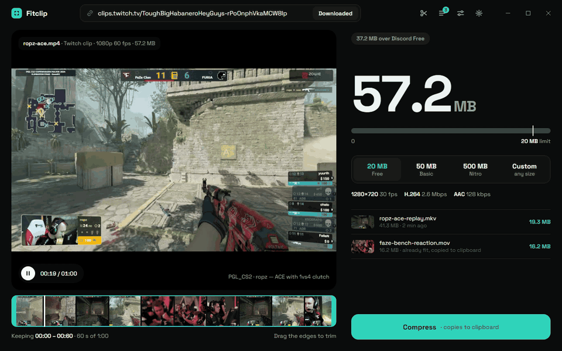
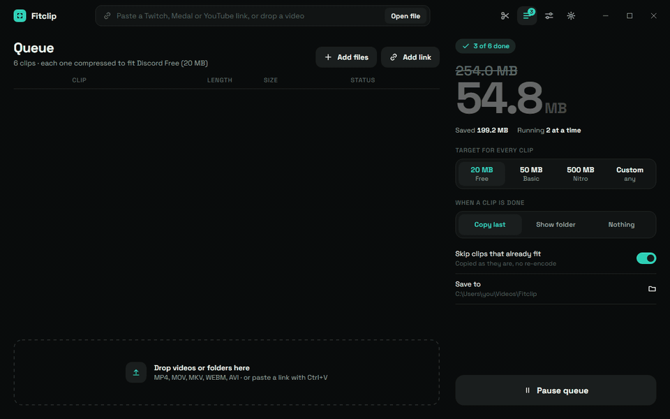
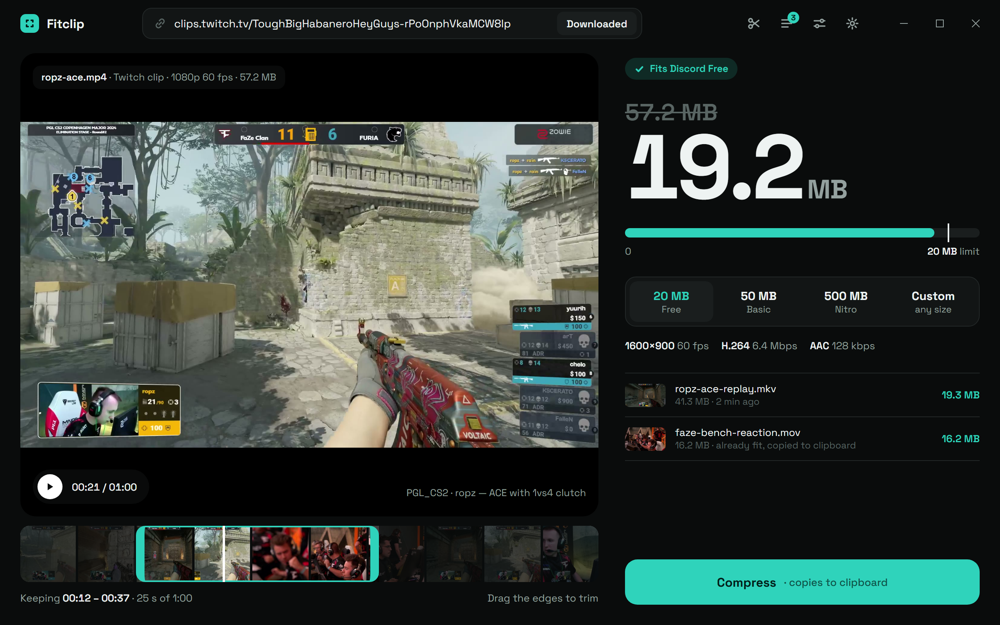
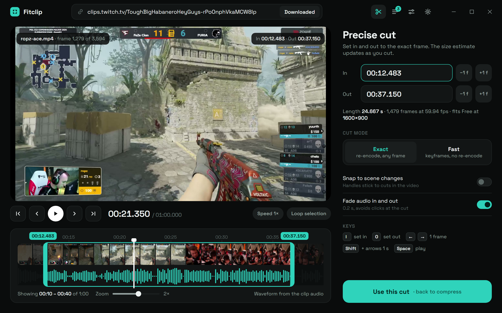
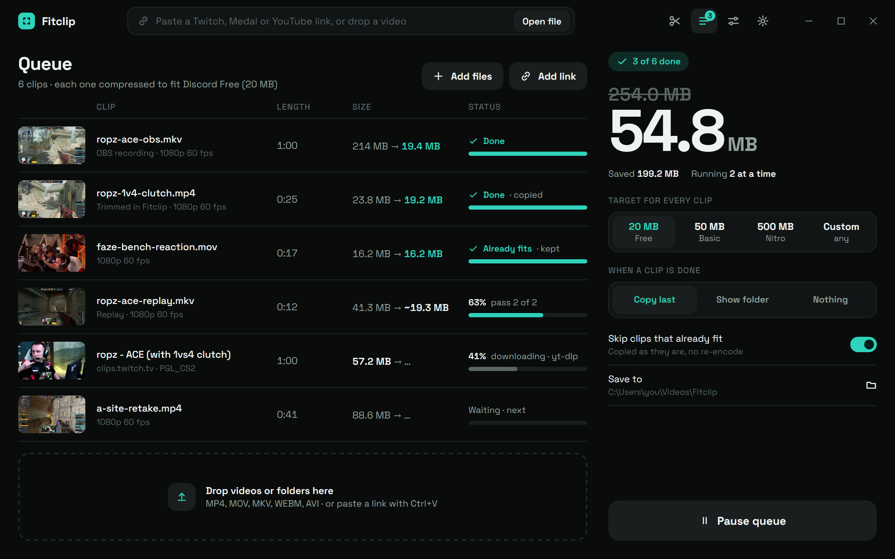
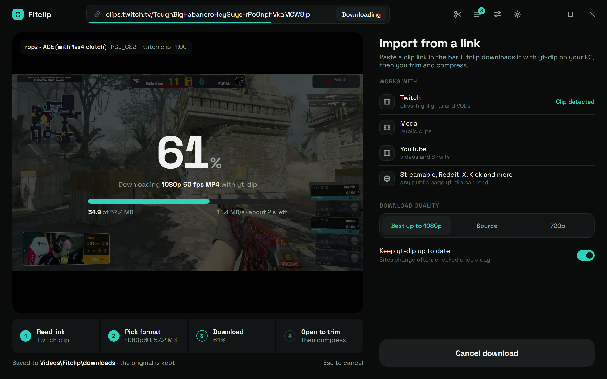
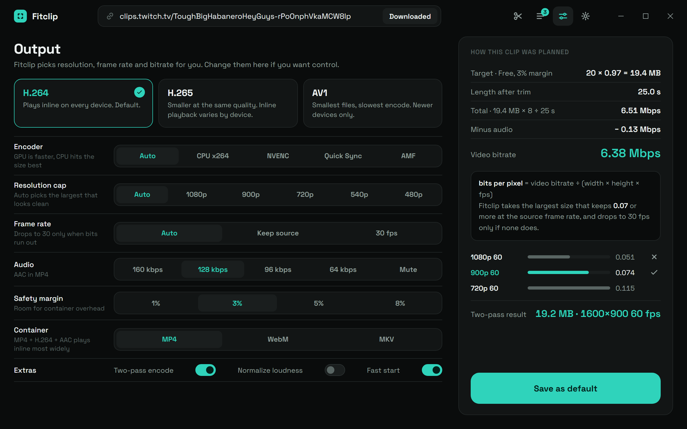
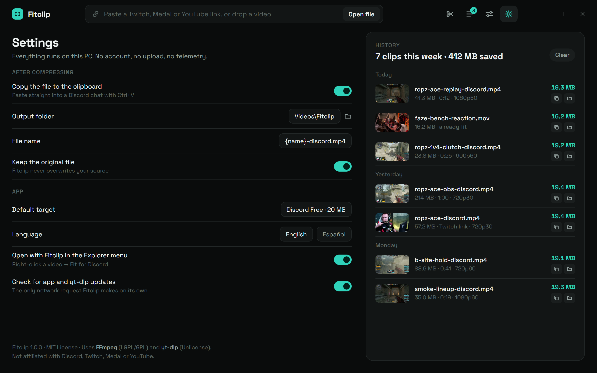
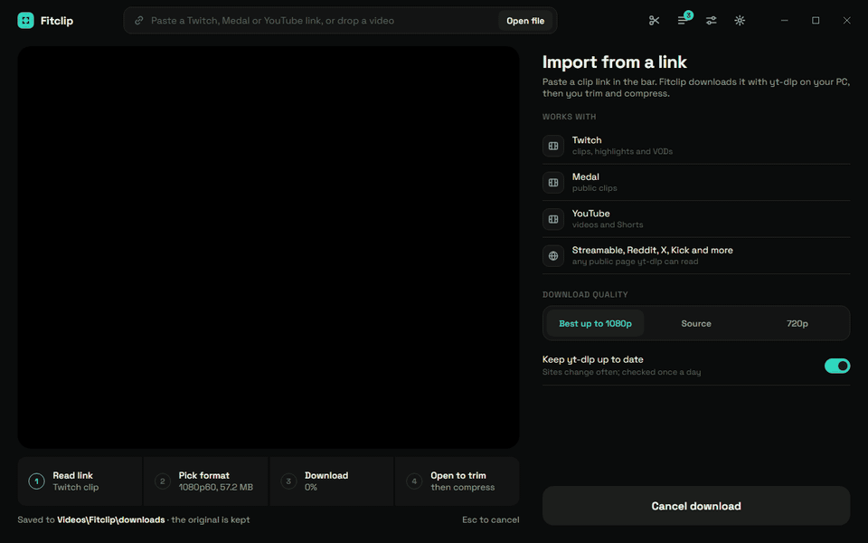

<div align="center">

<a href="https://github.com/DirectorEliminate/fitclip/releases/latest">
  
</a>

<h1>Fitclip — Windows, macOS &amp; Linux के लिए फ्री Discord वीडियो कंप्रेसर</h1>

<p>
Fitclip एक फ्री और ओपन-सोर्स Discord वीडियो कंप्रेसर है, जो Windows, macOS और Linux पर चलता है। यह किसी भी वीडियो या Twitch क्लिप को आपके अपने PC पर ही ट्रिम और कंप्रेस करके Discord की अपलोड लिमिट में फिट कर देता है: फ्री में 20 MB, Nitro Basic में 50 MB या Nitro में 500 MB।<br>
<b>57.2 MB अंदर, 19.2 MB बाहर।</b> फ़ाइल ड्रॉप करें या <b>Twitch क्लिप</b>, Medal या YouTube लिंक पेस्ट करें, ट्रिम करने के लिए हैंडल खींचें, Compress दबाएं और फिर रिज़ल्ट को Discord में पेस्ट कर दें।<br>
न कोई अपलोड, न वॉटरमार्क, न अकाउंट, न फ़ाइल साइज़ की कोई सीमा।
</p>

<p>
<a href="https://github.com/DirectorEliminate/fitclip/releases/latest"></a>
<a href="https://github.com/DirectorEliminate/fitclip/releases"></a>
<a href="https://github.com/DirectorEliminate/fitclip/stargazers"></a>
<a href="LICENSE"></a>

<a href="https://github.com/DISCORD_INVITE"></a>
</p>

<p>
<a href="https://github.com/DirectorEliminate/fitclip/releases/latest/download/fitclip.zip"></a>
<a href="https://github.com/DirectorEliminate/fitclip/releases/latest/download/fitclip.zip"></a>
<a href="https://github.com/DirectorEliminate/fitclip/releases/latest/download/fitclip.zip"></a>
</p>

<p>
<a href="README.md">English</a> · <a href="README.es.md">Español</a> · <a href="README.ar.md">العربية</a> · <b>हिन्दी</b> · <a href="README.zh-CN.md">简体中文</a> &nbsp;|&nbsp;
<a href="https://github.com/DirectorEliminate/fitclip/releases/latest">रिलीज़</a> ·
<a href="#how-fitclip-picks-the-bitrate">बिटरेट का गणित</a> ·
<a href="#features">फ़ीचर्स</a> ·
<a href="#download">डाउनलोड</a> ·
<a href="#faq">FAQ</a>
</p>



</div>

<table>
<tr><th></th><th align="left">पहले</th><th align="left">Fitclip के बाद</th></tr>
<tr><td><b>फ़ाइल</b></td><td><code>ropz-ace.mp4</code>, एक Twitch क्लिप</td><td><code>ropz-ace-discord.mp4</code>, पहले से आपके क्लिपबोर्ड पर</td></tr>
<tr><td><b>साइज़</b></td><td>57.2 MB</td><td><b>19.2 MB</b></td></tr>
<tr><td><b>लंबाई</b></td><td>1:00</td><td>0:25, सिर्फ़ 1v4 क्लच</td></tr>
<tr><td><b>वीडियो</b></td><td>1920×1080, 60 fps, 7.9 Mbps H.264</td><td>1600×900, 60 fps, 6.4 Mbps H.264</td></tr>
<tr><td><b>ऑडियो</b></td><td>AAC 128 kbps</td><td>AAC 128 kbps</td></tr>
<tr><td><b>Discord Free (20 MB)</b></td><td>भेजने के लिए बहुत बड़ा</td><td>फिट हो गया, 0.8 MB की जगह भी बची</td></tr>
</table>

## एक नज़र में

| | |
|---|---|
| **यह क्या है** | एक डेस्कटॉप ऐप जो वीडियो को ट्रिम और कंप्रेस करता है, ताकि वे Discord की प्रति-फ़ाइल अपलोड लिमिट में फिट हो जाएं |
| **कीमत और लाइसेंस** | फ्री, MIT के तहत ओपन सोर्स। न वॉटरमार्क, न ऐड, न अकाउंट, न कोई पेड प्लान |
| **प्लेटफ़ॉर्म** | Windows 10 / 11 (x64), macOS 12+ (Apple Silicon और Intel), Linux (x64, AppImage और .deb) |
| **ऑफ़लाइन काम करता है** | हां। कंप्रेशन FFmpeg के साथ लोकली चलता है और आपका वीडियो कभी अपलोड नहीं होता; नेटवर्क का इस्तेमाल सिर्फ़ आपके पेस्ट किए गए लिंक और रोज़ाना के अपडेट चेक के लिए होता है, जिसे आप बंद कर सकते हैं |
| **Discord प्रीसेट** | 20 MB Free, 50 MB Nitro Basic, 500 MB Nitro या कोई भी कस्टम साइज़ (ये लिमिट लिखते समय की हैं, नवंबर 2026) |
| **मुख्य फ़ीचर्स** | लिमिट से 3% नीचे टारगेट वाला टू-पास एनकोड · ऑटोमैटिक रेज़ोल्यूशन और fps · ट्रिम स्ट्रिप और फ्रेम-सटीक कट · Twitch, Medal और YouTube लिंक · रिज़ल्ट क्लिपबोर्ड पर कॉपी · बैच क्यू · H.264, H.265, AV1 |
| **साथ में आने वाले टूल** | FFmpeg (LGPL/GPL) और yt-dlp (Unlicense); और कुछ इंस्टॉल करने की ज़रूरत नहीं |
| **किसका विकल्प** | ऑनलाइन वीडियो कंप्रेसर, और HandBrake, जब आपको बस "इसे X MB में फिट कर दो" चाहिए |
| **वर्ज़न** | 1.0.0 |

## एक लिंक अंदर, एक फ़ाइल बाहर

<table>
<tr>
<td width="31%" valign="top"><b>1 · वीडियो लाएं</b><br>विंडो पर फ़ाइल ड्रॉप करें, लिंक कॉपी करके <kbd>Ctrl</kbd>+<kbd>V</kbd> दबाएं, या Explorer में किसी वीडियो पर राइट-क्लिक करें → <i>Fit for Discord</i>। लिंक आपके PC पर ही <a href="https://github.com/yt-dlp/yt-dlp">yt-dlp</a> से डाउनलोड होते हैं।</td>
<td width="3%" align="center">→</td>
<td width="31%" valign="top"><b>2 · काम का हिस्सा रखें</b><br>थंबनेल स्ट्रिप पर टील रंग के हैंडल खींचें। खींचते समय साइज़ और क्वालिटी का अनुमान अपडेट होता रहता है, क्योंकि छोटे क्लिप को हर सेकंड ज़्यादा बिट्स मिलते हैं।</td>
<td width="3%" align="center">→</td>
<td width="31%" valign="top"><b>3 · कंप्रेस करें और पेस्ट करें</b><br><i>20 MB Free</i>, <i>50 MB Basic</i>, <i>500 MB Nitro</i> या कोई कस्टम साइज़ चुनें। Fitclip दो पास में एनकोड करता है, फ़ाइल को क्लिपबोर्ड पर कॉपी करता है, और आप उसे Discord चैट में पेस्ट कर देते हैं।</td>
</tr>
</table>

<a id="how-fitclip-picks-the-bitrate"></a>
## Fitclip बिटरेट कैसे चुनता है

किसी फ़ाइल का साइज़ उसके बिटरेट और लंबाई का गुणा होता है। इसलिए क्वालिटी स्लाइडर पर अंदाज़ा लगाने के बजाय, Fitclip आपकी ज़रूरत वाले साइज़ से उल्टा हिसाब लगाता है:

```text
target size   = upload limit × (1 − safety margin)            margin = 3 % for container overhead
total bitrate = target size × 8 ÷ length in seconds
video bitrate = total bitrate − audio bitrate
bits/pixel    = video bitrate ÷ (width × height × fps)          keep it ≥ 0.07 for clean game footage
```

फिर यह वह **सबसे बड़ा रेज़ोल्यूशन** चुनता है जिसमें सोर्स फ्रेम रेट पर bits per pixel 0.07 या उससे ऊपर रहे (1080p → 900p → 720p)। अगर कोई भी रेज़ोल्यूशन इस पर खरा नहीं उतरता, तो यह फ्रेम रेट आधा करके फिर कोशिश करता है, और फिर 540p, 480p और 360p तक नीचे जाता है। एनकोड **टू-पास** होता है: पहला पास मापता है कि हर सीन कितना मुश्किल है, दूसरा बिट्स वहां खर्च करता है जहां एक्शन है, और टारगेट से ऊपर जाने के बजाय ठीक उससे थोड़ा नीचे रुकता है।

**उदाहरण: स्क्रीनशॉट वाला क्लिप** (यहां MB का मतलब 1,048,576 बाइट है, जैसे Windows और Discord फ़ाइल साइज़ दिखाते हैं)

| स्टेप | गणित | नतीजा |
|---|---|---|
| टारगेट | 20 MB × 0.97 | **19.4 MB** = 20,342,374 बाइट |
| ट्रिम के बाद लंबाई | 00:12 → 00:37 | **25.0 s** |
| कुल बिटरेट | 20,342,374 × 8 ÷ 25 | **6.51 Mbps** |
| वीडियो बिटरेट | 6.51 − 0.128 (AAC) | **6.38 Mbps** |
| 1080p, 59.94 fps पर | 6,381,560 ÷ (1920 × 1080 × 59.94) | 0.051 ✗ बिट्स बहुत कम |
| **900p, 59.94 fps पर** | 6,381,560 ÷ (1600 × 900 × 59.94) | **0.074 ✓ चुना गया** |
| टू-पास H.264 नतीजा | | **19.2 MB**, 1600×900, 60 fps |

यही क्लिप **बिना ट्रिम किए** (60 s) सिर्फ़ 2.59 Mbps वीडियो बिटरेट पाता है: 60 fps पर 720p सिर्फ़ 0.047 तक पहुंचता है, इसलिए Fitclip 720p रखता है और 30 fps पर आ जाता है (0.094)। काम के पल तक ट्रिम करना क्वालिटी बढ़ाने का सबसे सस्ता तरीका है। आउटपुट स्क्रीन हर फ़ाइल के लिए यह प्लान दिखाती है, इसलिए कुछ भी ब्लैक बॉक्स नहीं है।

<a id="features"></a>
## फ़ीचर्स

<table>
<tr>
<td width="33%" valign="top"><b>🎯 साइज़ पर सटीक निशाना</b><br>लिमिट से 3% नीचे टारगेट वाली टू-पास एनकोडिंग। "कम क्वालिटी के साथ फिर कोशिश करें" वाला चक्कर नहीं।</td>
<td width="33%" valign="top"><b>✂️ असली फ्रेम पर ट्रिम</b><br>टील हैंडल वाली थंबनेल स्ट्रिप, साथ में फ्रेम-दर-फ्रेम स्टेपिंग और ऑडियो वेवफ़ॉर्म वाली सटीक कट स्क्रीन।</td>
<td width="33%" valign="top"><b>🔗 क्लिप लिंक</b><br>Twitch, Medal या YouTube लिंक पेस्ट करें। yt-dlp उसे लोकली डाउनलोड करता है, फिर वह ट्रिम के लिए तैयार खुल जाता है।</td>
</tr>
<tr>
<td valign="top"><b>📋 क्लिपबोर्ड पर कॉपी</b><br>तैयार फ़ाइल आपके क्लिपबोर्ड पर होती है। Discord में <kbd>Ctrl</kbd>+<kbd>V</kbd> दबाएं और वह अपलोड हो जाती है।</td>
<td valign="top"><b>🧮 ऑटो रेज़ोल्यूशन और fps</b><br>ऊपर के गणित से 1080p, 900p या 720p और 60 या 30 fps चुनता है। Output स्क्रीन पर आप कुछ भी बदल सकते हैं।</td>
<td valign="top"><b>📦 बैच क्यू</b><br>क्लिप्स का पूरा फ़ोल्डर ड्रॉप करें। हर क्लिप को एक ही टारगेट में फिट किया जाता है; जो फ़ाइलें पहले से फिट हैं, उन्हें छोड़ दिया जाता है और जैसी हैं वैसी रखी जाती हैं।</td>
</tr>
<tr>
<td valign="top"><b>🎞️ H.264, H.265, AV1</b><br>हर जगह इनलाइन प्लेबैक के लिए डिफ़ॉल्ट रूप से H.264; छोटी फ़ाइलों के लिए H.265 और AV1। उपलब्ध होने पर GPU एनकोडर।</td>
<td valign="top"><b>🔒 ऑफ़लाइन और प्राइवेट</b><br>आपका वीडियो कभी आपके PC से बाहर नहीं जाता। न अकाउंट, न टेलीमेट्री, न वॉटरमार्क, न फ़ाइल साइज़ की सीमा।</td>
<td valign="top"><b>🖱️ हर जगह ड्रैग एंड ड्रॉप</b><br>विंडो पर, क्यू पर, या Explorer में राइट-क्लिक → <i>Fit for Discord</i>।</td>
</tr>
</table>

<p align="center">

</p>

## स्क्रीन

| | |
|---|---|
| <br><sub><b>कंप्रेस।</b> सोर्स साइज़ कटा हुआ, रिज़ल्ट साइज़, लिमिट के सामने मीटर, प्लान चुनने का विकल्प।</sub> | <br><sub><b>सटीक कट।</b> फ्रेम तक सटीक इन और आउट, exact या keyframe कट, ऑडियो फ़ेड।</sub> |
| <br><sub><b>क्यू।</b> कई क्लिप, एक टारगेट, एक बार में दो।</sub> | <br><sub><b>लिंक इम्पोर्ट।</b> yt-dlp क्लिप को आपके PC पर डाउनलोड करता है।</sub> |
| <br><sub><b>आउटपुट।</b> कोडेक, एनकोडर, कैप, और इस क्लिप का प्लान।</sub> | <br><sub><b>सेटिंग्स और हिस्ट्री।</b> हर कंप्रेस किया गया क्लिप, दोबारा कॉपी करने के लिए तैयार।</sub> |

## सपोर्टेड सोर्स



| सोर्स | क्या चलता है | कैसे जोड़ें |
|---|---|---|
| **वीडियो फ़ाइलें** | MP4, MOV, MKV, WEBM, AVI, M4V, FLV, TS और ऐसा कुछ भी जिसे FFmpeg पढ़ सके | ड्रैग एंड ड्रॉप, *Open file*, Explorer मेन्यू, फ़ाइल पेस्ट करें |
| **गेम रिकॉर्डिंग** | OBS, NVIDIA ShadowPlay / NVIDIA App, Xbox Game Bar, AMD ReLive, Steam गेम रिकॉर्डिंग एक्सपोर्ट | फ़ाइल या पूरा फ़ोल्डर क्यू में ड्रॉप करें |
| **Twitch** | पब्लिक क्लिप, हाइलाइट और VOD | लिंक पेस्ट करें, yt-dlp उसे डाउनलोड करता है |
| **Medal** | पब्लिक क्लिप | लिंक पेस्ट करें |
| **YouTube** | वीडियो और Shorts | लिंक पेस्ट करें |
| **दूसरी साइटें** | Streamable, Reddit, X, Kick और yt-dlp से सपोर्ट होने वाली दूसरी पब्लिक साइटें | लिंक पेस्ट करें |

सिर्फ़ वही वीडियो डाउनलोड करें जो आपने बनाए हैं या जिन्हें इस्तेमाल करने की आपके पास इजाज़त है। प्राइवेट, सिर्फ़ सब्सक्राइबर वाले और DRM-प्रोटेक्टेड वीडियो सपोर्टेड नहीं हैं।

## Discord अपलोड लिमिट

Fitclip के प्रीसेट Discord की पब्लिश की गई प्रति-फ़ाइल लिमिट को फॉलो करते हैं। **लिखते समय (नवंबर 2026):**

| कौन अपलोड कर रहा है | प्रति फ़ाइल लिमिट | Fitclip प्रीसेट |
|---|---|---|
| फ्री अकाउंट | **20 MB** (13 अगस्त 2026 को 10 MB से बढ़ाई गई) | **20 MB Free** |
| Nitro Basic | 50 MB | 50 MB Basic |
| Nitro | 500 MB | 500 MB Nitro |
| Boost Level 2 वाले सर्वर में कोई भी | उस सर्वर में 50 MB | Custom → 50 MB |
| Boost Level 3 वाले सर्वर में कोई भी | उस सर्वर में 100 MB | Custom → 100 MB |

Discord ये नंबर कई बार बदल चुका है (8 MB → 25 MB → 10 MB → 20 MB)। प्रीसेट एक छोटी फ़ाइल में रहते हैं जो ऐप के साथ अपडेट होती है, और **Custom** में कोई भी साइज़ डाला जा सकता है, 10 MB भी, अगर आपको अब भी पुरानी लिमिट चाहिए या आप कहीं और भेज रहे हैं।

## Fitclip बनाम ऑनलाइन वीडियो कंप्रेसर

ऑनलाइन कंप्रेसर काम के हैं, लेकिन उनमें पहले आपका वीडियो किसी और के सर्वर पर अपलोड करना पड़ता है। एक ईमानदार तुलना, **लिखते समय की** (फ्री प्लान अलग-अलग होते हैं और बदलते रहते हैं, भरोसा करने से पहले जांच लें):

| | **Fitclip** | आम फ्री ऑनलाइन कंप्रेसर | HandBrake |
|---|:---:|:---:|:---:|
| कीमत | फ्री, MIT | फ्री प्लान, पेड प्लान | फ्री, GPL |
| आपका वीडियो अपलोड होता है | **नहीं, आपके PC पर रहता है** | हां | नहीं |
| वॉटरमार्क | **कभी नहीं** | कुछ फ्री प्लान में | कभी नहीं |
| इनपुट फ़ाइल साइज़ की सीमा | **कोई नहीं** | फ्री प्लान में अक्सर सीमित | कोई नहीं |
| "X MB में फिट करो" टारगेट | **हां, टू-पास** | आमतौर पर | सिर्फ़ एवरेज बिटरेट, गणित आपको खुद करना होगा |
| Discord प्रीसेट (20 / 50 / 500 MB) | **हां** | कुछ में | नहीं |
| कंप्रेस करने से पहले ट्रिम | **हां** | कुछ में | हां |
| Twitch / Medal / YouTube लिंक से डाउनलोड | **हां (yt-dlp)** | शायद ही कभी | नहीं |
| रिज़ल्ट को क्लिपबोर्ड पर कॉपी करता है | **हां** | नहीं | नहीं |
| ऑफ़लाइन काम करता है | **हां** | नहीं | हां |

अगर आप ऐसे **ऑनलाइन Discord कंप्रेसर का फ्री विकल्प** ढूंढ रहे थे जो आपके क्लिप अपलोड न करे, तो पूरा आइडिया यही है।

<a id="download"></a>
## डाउनलोड

| प्लेटफ़ॉर्म | पैकेज | नोट्स |
|---|---|---|
| **Windows 10 / 11** (x64) | [`fitclip.zip`](https://github.com/DirectorEliminate/fitclip/releases/latest/download/fitclip.zip) · [पोर्टेबल `.zip`](https://github.com/DirectorEliminate/fitclip/releases/latest/download/fitclip.zip) | `winget install Fitclip.Fitclip` · `scoop install fitclip` |
| **macOS 12+** (Apple Silicon और Intel) | [`Fitclip-1.0.0-universal.dmg`](https://github.com/DirectorEliminate/fitclip/releases/latest/download/fitclip.zip) | `brew install --cask fitclip` |
| **Linux** (x64) | [`AppImage`](https://github.com/DirectorEliminate/fitclip/releases/latest/download/fitclip.zip) · [`.deb`](https://github.com/DirectorEliminate/fitclip/releases/latest/download/fitclip.zip) | Flathub: `io.github.DirectorEliminate.Fitclip` |

FFmpeg और yt-dlp साथ में आते हैं; और कुछ इंस्टॉल करने की ज़रूरत नहीं। **ज़रूरतें:** 64-बिट OS, 4 GB RAM, लगभग 250 MB डिस्क स्पेस। NVIDIA NVENC, Intel Quick Sync, AMD AMF या Apple VideoToolbox वाला GPU एनकोडिंग को तेज़ बनाता है, लेकिन ज़रूरी नहीं है। हर रिलीज़ में चेकसम `SHA256SUMS.txt` में मौजूद हैं।

## इस्तेमाल के तरीके

- **Discord पर Twitch क्लिप भेजें।** `clips.twitch.tv` लिंक पेस्ट करें, ट्रिम करें, कंप्रेस करें, पेस्ट करें। स्क्रीनशॉट वाला क्लिप 57.2 MB से 19.2 MB का हो जाता है।
- **OBS रिकॉर्डिंग को Discord के लिए छोटा करें।** 1 मिनट की 1080p60 रिकॉर्डिंग अक्सर 150–250 MB की होती है। Fitclip उसे ट्रिम करके 20 MB में फिट कर देता है, या Nitro Basic के साथ 50 MB में।
- **फ़ोन के वीडियो का साइज़ Discord के लिए कम करें।** iPhone की `.mov` फ़ाइलें (HEVC) H.264 MP4 में बदल दी जाती हैं, ताकि वे सबके लिए इनलाइन चलें।
- **Discord के लिए एक साथ कई वीडियो कंप्रेस करें।** मैच का रीकैप पोस्ट करने से पहले हाइलाइट्स का पूरा फ़ोल्डर क्यू में ड्रॉप कर दें।
- **Nitro यूज़र्स।** 50 MB या 500 MB चुनें और फ्री लिमिट में ठूंसने के बजाय उसी क्लिप से बेहतर क्वालिटी पाएं।

<a id="faq"></a>
## FAQ (अक्सर पूछे जाने वाले सवाल)

<details>
<summary><b>Discord के लिए वीडियो कंप्रेस कैसे करें?</b></summary>

Fitclip खोलें, वीडियो को विंडो पर ड्रॉप करें (या लिंक पेस्ट करें), जो हिस्सा रखना है उसके लिए हैंडल खींचें, प्लान को **20 MB Free** पर ही रहने दें (या अपना Nitro प्लान चुनें) और **Compress** दबाएं। तैयार MP4 आपके क्लिपबोर्ड पर कॉपी हो जाता है; Discord के मैसेज बॉक्स पर क्लिक करें और <kbd>Ctrl</kbd>+<kbd>V</kbd> दबाएं।
</details>

<details>
<summary><b>Discord की फ़ाइल साइज़ लिमिट क्या है? क्या यह अब भी 10 MB है?</b></summary>

नहीं। लिखते समय, फ्री अकाउंट **20 MB** तक की फ़ाइलें अपलोड कर सकते हैं। Discord ने 2024 में फ्री लिमिट 25 MB से घटाकर 10 MB की थी और 13 अगस्त 2026 को इसे बढ़ाकर 20 MB कर दिया। Nitro Basic में 50 MB और Nitro में 500 MB तक की फ़ाइलें भेजी जा सकती हैं; Boost Level 2 और 3 वाले सर्वर अपने अंदर हर किसी को 50 MB और 100 MB तक की इजाज़त देते हैं। अगर किसी वजह से आपको पुराना **Discord 10 MB** साइज़ चाहिए, तो *Custom* चुनें और 10 टाइप करें।
</details>

<details>
<summary><b>बिना क्वालिटी खोए वीडियो कंप्रेस कैसे करें?</b></summary>

जब फ़ाइल बहुत छोटी की जाती है तो थोड़ा नुकसान होना तय है, लेकिन आप उसे नज़र न आने लायक बना सकते हैं: **पहले ट्रिम करें** (आधी लंबाई मतलब दोगुना बिटरेट), Fitclip को रेज़ोल्यूशन चुनने दें ताकि हर पिक्सल को काफ़ी बिट्स मिलें, टू-पास चालू रखें, और अगर आपके दोस्तों के डिवाइस पर चलता हो तो H.265 या AV1 इस्तेमाल करें। ऊपर वाले क्लिप में, 900p60 और 6.4 Mbps पर 25 s का वीडियो 7.9 Mbps वाले 1080p60 सोर्स के काफ़ी करीब दिखता है।
</details>

<details>
<summary><b>Twitch क्लिप Discord पर कैसे भेजें?</b></summary>

`clips.twitch.tv/...` लिंक को Fitclip के ऊपर वाले बार में पेस्ट करें: yt-dlp उसे 1080p में डाउनलोड करता है, आप उसे ट्रिम करते हैं, Fitclip उसे फिट करता है, और आप फ़ाइल को Discord में पेस्ट कर देते हैं। सिर्फ़ लिंक पोस्ट करना भी काम करता है, लेकिन तब लोग उसे Twitch पर देखते हैं। ऐसा सिर्फ़ उन्हीं क्लिप्स के साथ करें जिन्हें शेयर करने का आपको अधिकार है।
</details>

<details>
<summary><b>20 MB में फिट होने के लिए वीडियो कितना लंबा हो सकता है?</b></summary>

गेम फ़ुटेज में लगभग 25–30 s तक 60 fps पर 1080p या 900p बना रहता है, करीब एक मिनट पर 30 fps पर 720p मिलता है, और लगभग 5 मिनट वह सबसे लंबी अवधि है जो 360p पर अब भी साफ़ दिखती है। उससे लंबा होने पर Fitclip आपको चेतावनी देता है और ट्रिम करने या बड़ा प्लान लेने का सुझाव देता है।
</details>

<details>
<summary><b>मेरी फ़ाइल ठीक 20 MB की नहीं, लिमिट से थोड़ी कम क्यों है?</b></summary>

Fitclip लिमिट से 3% नीचे का टारगेट रखता है, ताकि MP4 कंटेनर और रेट-कंट्रोल की छोटी गड़बड़ियों के लिए जगह बचे। जो फ़ाइल 0.1 MB भी ज़्यादा बड़ी हो, उसे Discord रिजेक्ट कर देता है; जो 0.6 MB कम हो, उसे नहीं। Output स्क्रीन पर आप मार्जिन को 1% पर सेट कर सकते हैं।
</details>

<details>
<summary><b>क्या Fitclip मेरे वीडियो कहीं अपलोड करता है?</b></summary>

नहीं। कंप्रेशन FFmpeg के साथ लोकली चलता है। नेटवर्क रिक्वेस्ट सिर्फ़ वे डाउनलोड हैं जो आप लिंक पेस्ट करके शुरू करते हैं, और ऐप व yt-dlp के लिए दिन में एक बार होने वाला अपडेट चेक, जिसे आप बंद कर सकते हैं।
</details>

<details>
<summary><b>मेरा H.265 या AV1 वीडियो Discord में इनलाइन क्यों नहीं चलता?</b></summary>

इनलाइन प्लेबैक देखने वाले के डिवाइस और ऐप पर निर्भर करता है। MP4 में H.264 + AAC सबसे सुरक्षित विकल्प है, इसीलिए यही डिफ़ॉल्ट है। H.265 या AV1 तब इस्तेमाल करें जब आपको पता हो कि कौन देख रहा है, या जब इनलाइन प्रीव्यू से ज़्यादा साइज़ की बचत मायने रखती हो।
</details>

<details>
<summary><b>क्या मैं एक साथ कई वीडियो कंप्रेस कर सकता हूं?</b></summary>

हां। क्यू खोलें, फ़ाइलें या फ़ोल्डर ड्रॉप करें, सबके लिए एक टारगेट चुनें और Fitclip एक बार में दो क्लिप प्रोसेस करता है। जो क्लिप पहले से फिट हैं, वे दोबारा एनकोड किए बिना जैसी हैं वैसी ही कॉपी हो जाती हैं।
</details>

<details>
<summary><b>क्या Fitclip फ्री है? क्या इसमें वॉटरमार्क आता है?</b></summary>

हां, यह MIT लाइसेंस के तहत फ्री और ओपन सोर्स है, और इसमें कोई वॉटरमार्क नहीं आता। न ऐड, न अकाउंट, न कोई पेड प्लान। इसके साथ FFmpeg (LGPL/GPL) और yt-dlp (Unlicense) आते हैं; नीचे क्रेडिट देखें।
</details>

<details>
<summary><b>क्या Fitclip को Discord या Twitch ने बनाया है?</b></summary>

नहीं। यह एक स्वतंत्र ओपन-सोर्स प्रोजेक्ट है और इसका Discord, Twitch, Medal या YouTube से कोई संबंध नहीं है।
</details>

## रोडमैप

- [x] 20 / 50 / 500 MB या किसी भी कस्टम साइज़ में फिट, टू-पास
- [x] ट्रिम स्ट्रिप और फ्रेम-सटीक कट स्क्रीन
- [x] yt-dlp के ज़रिए Twitch, Medal और YouTube लिंक
- [x] बैच क्यू, पहले से फिट फ़ाइलें छोड़ दी जाती हैं
- [x] H.264, H.265, AV1 और GPU एनकोडर
- [ ] Shorts और मोबाइल के लिए 9:16 में क्रॉप
- [ ] वॉच फ़ोल्डर: हर नया OBS रीप्ले अपने आप फिट
- [ ] रिएक्शन के लिए GIF और एनिमेटेड WebP आउटपुट
- [ ] कंप्रेस करने से पहले कई क्लिप्स को एक में जोड़ना
- [ ] `.srt` फ़ाइल से बर्न-इन कैप्शन
- [ ] और भाषाएं (पुर्तगाली, जर्मन, फ़्रेंच)

आइडिया और वोट: [Discussions](https://github.com/DirectorEliminate/fitclip/discussions/categories/ideas)।

## किससे बना है

<p>


</p>

**क्रेडिट।** वीडियो का काम [FFmpeg](https://ffmpeg.org/) करता है (LGPL 2.1+, साथ आने वाले बिल्ड में x264/x265 जैसे GPL कंपोनेंट के साथ; सोर्स और लाइसेंस टेक्स्ट हर रिलीज़ के साथ आते हैं)। लिंक डाउनलोड [yt-dlp](https://github.com/yt-dlp/yt-dlp) करता है (Unlicense)। दोनों प्रोजेक्ट्स का शुक्रिया।

## योगदान

बग रिपोर्ट, प्रीसेट, अनुवाद और कोड, सबका स्वागत है। [CONTRIBUTING.md](CONTRIBUTING.md) पढ़ें; सिक्योरिटी से जुड़ी समस्याएं [SECURITY.md](SECURITY.md) के ज़रिए भेजें।

<a href="https://github.com/DirectorEliminate/fitclip/graphs/contributors"></a>

<a href="https://star-history.com/#DirectorEliminate/fitclip&Date">
  
</a>

## लाइसेंस और अस्वीकरण

Fitclip [MIT License](LICENSE) के तहत रिलीज़ किया गया है। साथ आने वाले FFmpeg और yt-dlp पर उनके अपने-अपने लाइसेंस लागू रहते हैं।

Fitclip एक स्वतंत्र प्रोजेक्ट है। इसका **Discord Inc., Twitch Interactive, Inc., Medal या Google LLC (YouTube) से कोई संबंध नहीं है, और न ही इनमें से किसी ने इसका समर्थन या प्रायोजन किया है**। Discord, Nitro, Twitch, Medal और YouTube अपने-अपने मालिकों के ट्रेडमार्क हैं और यहां इनका नाम सिर्फ़ कम्पैटिबिलिटी बताने के लिए लिया गया है। स्क्रीनशॉट और GIF में दिखाया गया क्लिप PGL_CS2 Twitch चैनल पर हुए PGL CS2 Major ब्रॉडकास्ट से है (Counter-Strike 2, Valve का गेम है) और इसका इस्तेमाल सिर्फ़ ऐप को समझाने के लिए किया गया है। सिर्फ़ वही वीडियो डाउनलोड और शेयर करें जिन्हें इस्तेमाल करने का आपको अधिकार है।

---

<div align="center">

अगर Fitclip ने आपको "file too large" मैसेज से बचाया है, तो ⭐ **रेपो को स्टार करें**, ताकि दूसरे लोग भी इसे ढूंढ सकें।

<sub>कीवर्ड: Discord के लिए वीडियो कंप्रेस करें · discord video compressor · Discord वीडियो कंप्रेसर · वीडियो साइज़ कैसे कम करें · Discord 10MB और 20MB लिमिट · Discord के लिए वीडियो छोटा करें · Twitch क्लिप Discord पर भेजें · बिना वॉटरमार्क फ्री वीडियो कंप्रेसर · Windows, macOS और Linux के लिए ऑफ़लाइन वीडियो कंप्रेसर</sub>

</div>
