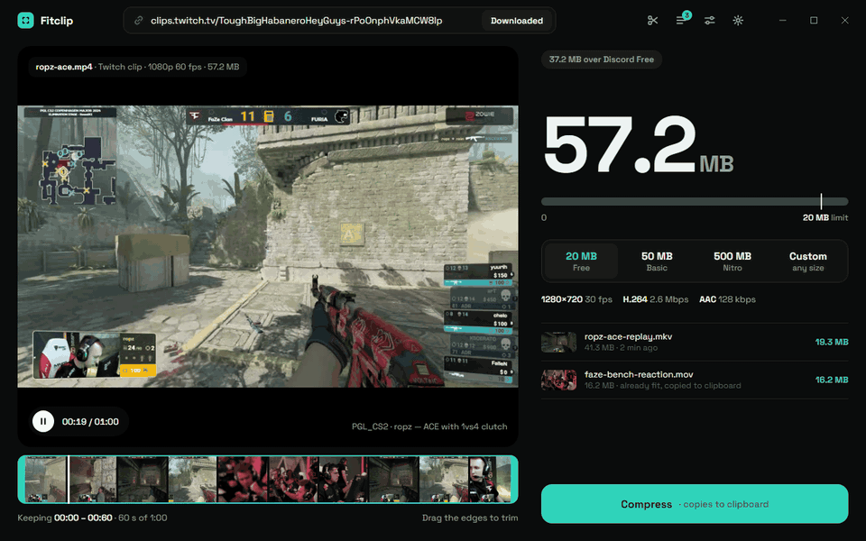
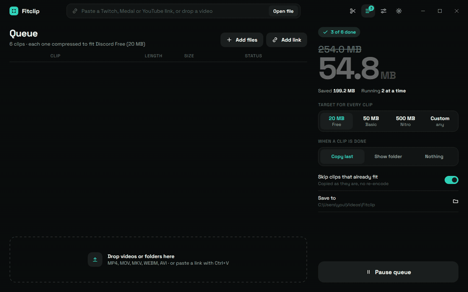
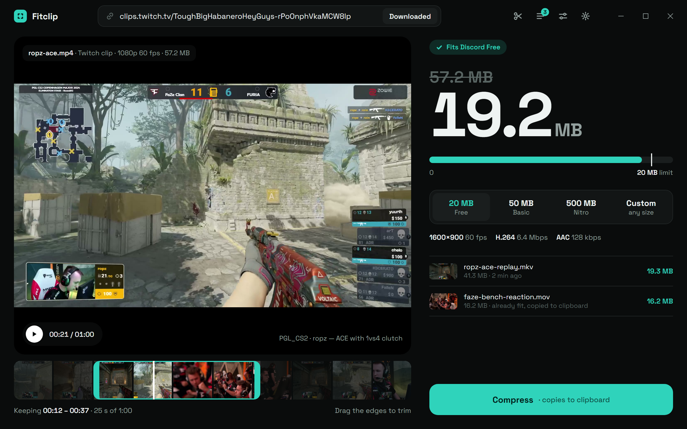
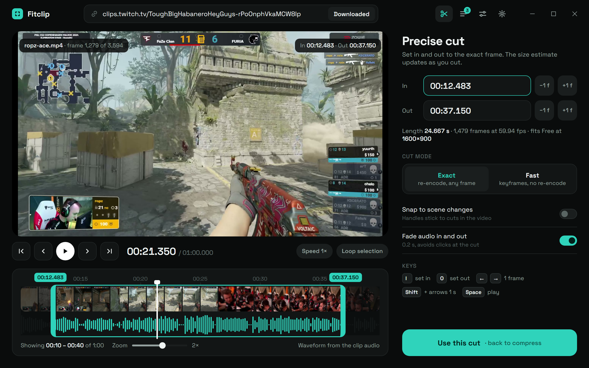
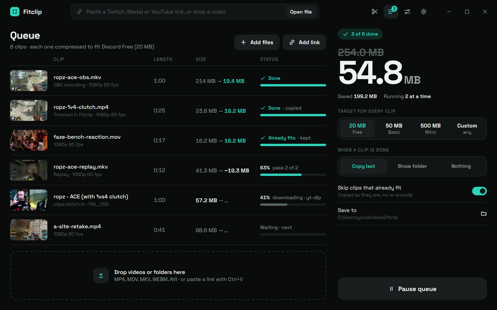
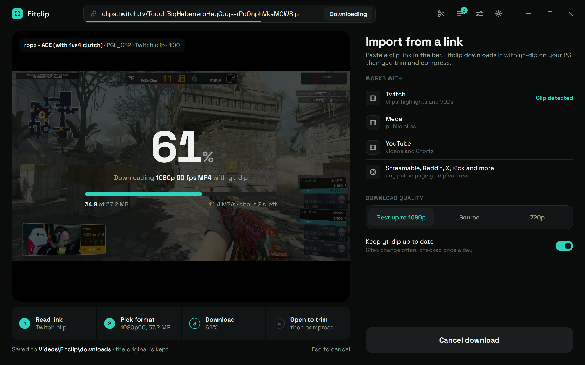
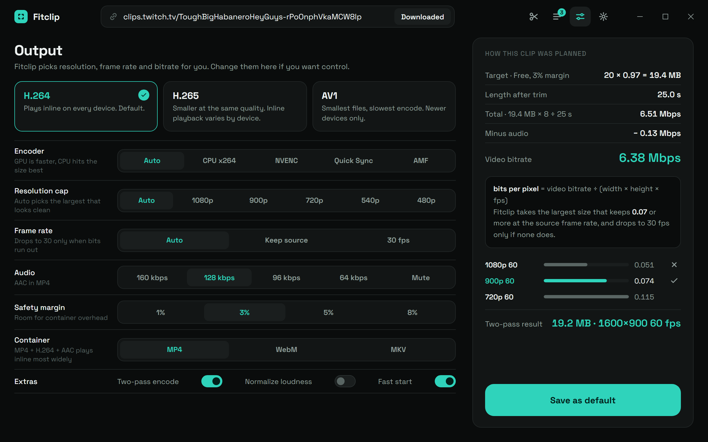
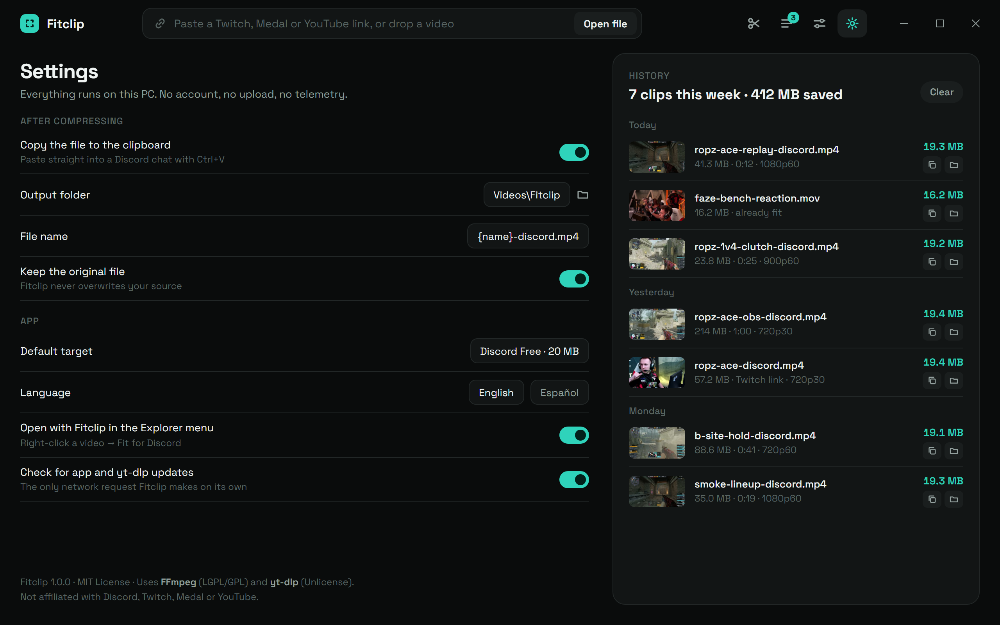
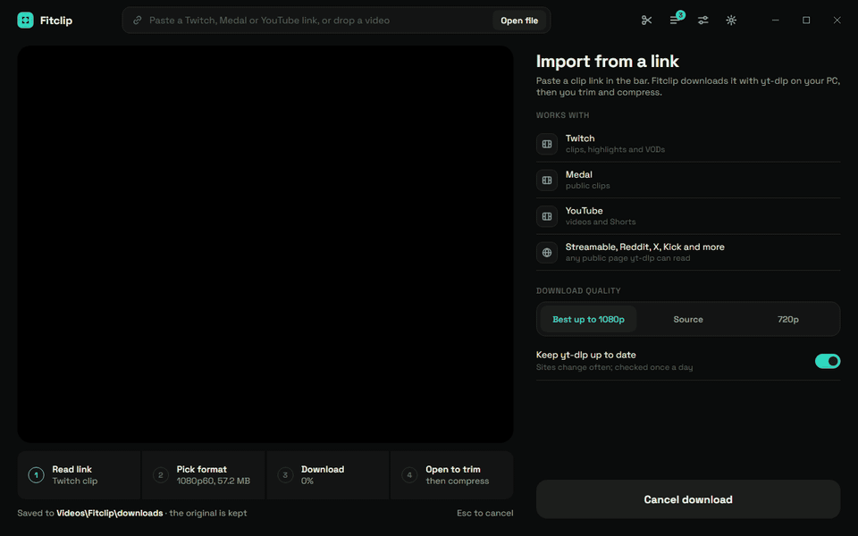

<div align="center">

<a href="https://github.com/DirectorEliminate/fitclip/releases/latest">
  
</a>

<h1>Fitclip — Free Discord Video Compressor for Windows, macOS &amp; Linux</h1>

<p>
Fitclip is a free, open-source Discord video compressor for Windows, macOS and Linux that trims and compresses any video or Twitch clip on your own PC to fit Discord's upload limit: 20 MB free, 50 MB Nitro Basic or 500 MB Nitro.<br>
<b>57.2 MB in, 19.2 MB out.</b> Drop a file or paste a <b>Twitch clip</b>, Medal or YouTube link, drag the handles to trim, press Compress, then paste the result into Discord.<br>
No upload, no watermark, no account, no file size cap.
</p>

<p>
<a href="https://github.com/DirectorEliminate/fitclip/releases/latest"></a>
<a href="https://github.com/DirectorEliminate/fitclip/releases"></a>
<a href="https://github.com/DirectorEliminate/fitclip/stargazers"></a>
<a href="LICENSE"></a>

<a href="https://github.com/DISCORD_INVITE"></a>
</p>

<p>
<a href="https://github.com/DirectorEliminate/fitclip/releases/latest/download/fitclip.zip"></a>
<a href="https://github.com/DirectorEliminate/fitclip/releases/latest/download/fitclip.zip"></a>
<a href="https://github.com/DirectorEliminate/fitclip/releases/latest/download/fitclip.zip"></a>
</p>

<p>
<b>English</b> · <a href="README.es.md">Español</a> · <a href="README.ar.md">العربية</a> · <a href="README.hi.md">हिन्दी</a> · <a href="README.zh-CN.md">简体中文</a> &nbsp;|&nbsp;
<a href="https://github.com/DirectorEliminate/fitclip/releases/latest">Releases</a> ·
<a href="#how-fitclip-picks-the-bitrate">The math</a> ·
<a href="#features">Features</a> ·
<a href="#download">Download</a> ·
<a href="#faq">FAQ</a>
</p>



</div>

<table>
<tr><th></th><th align="left">Before</th><th align="left">After Fitclip</th></tr>
<tr><td><b>File</b></td><td><code>ropz-ace.mp4</code>, a Twitch clip</td><td><code>ropz-ace-discord.mp4</code>, already on your clipboard</td></tr>
<tr><td><b>Size</b></td><td>57.2 MB</td><td><b>19.2 MB</b></td></tr>
<tr><td><b>Length</b></td><td>1:00</td><td>0:25, only the 1v4 clutch</td></tr>
<tr><td><b>Video</b></td><td>1920×1080, 60 fps, 7.9 Mbps H.264</td><td>1600×900, 60 fps, 6.4 Mbps H.264</td></tr>
<tr><td><b>Audio</b></td><td>AAC 128 kbps</td><td>AAC 128 kbps</td></tr>
<tr><td><b>Discord Free (20 MB)</b></td><td>Too big to send</td><td>Fits, with 0.8 MB to spare</td></tr>
</table>

## At a glance

| | |
|---|---|
| **What it is** | A desktop app that trims and compresses videos so they fit Discord's per-file upload limit |
| **Price and license** | Free, open source under MIT. No watermark, no ads, no account, no paid tier |
| **Platforms** | Windows 10 / 11 (x64), macOS 12+ (Apple Silicon and Intel), Linux (x64, AppImage and .deb) |
| **Works offline** | Yes. Compression runs locally with FFmpeg and your video is never uploaded; the only network use is links you paste and a daily update check you can turn off |
| **Discord presets** | 20 MB Free, 50 MB Nitro Basic, 500 MB Nitro, or any custom size (limits at time of writing, November 2026) |
| **Main features** | Two-pass encode aimed 3% under the limit · automatic resolution and fps · trim strip and frame-accurate cut · Twitch, Medal and YouTube links · result copied to the clipboard · batch queue · H.264, H.265, AV1 |
| **Bundled tools** | FFmpeg (LGPL/GPL) and yt-dlp (Unlicense); nothing else to install |
| **Alternative to** | Online video compressors, and HandBrake when all you need is "fit this into X MB" |
| **Version** | 1.0.0 |

## One link in, one file out

<table>
<tr>
<td width="31%" valign="top"><b>1 · Bring the video</b><br>Drop a file on the window, press <kbd>Ctrl</kbd>+<kbd>V</kbd> with a link, or right-click a video in Explorer → <i>Fit for Discord</i>. Links are downloaded by <a href="https://github.com/yt-dlp/yt-dlp">yt-dlp</a> on your PC.</td>
<td width="3%" align="center">→</td>
<td width="31%" valign="top"><b>2 · Keep the good part</b><br>Drag the teal handles on the thumbnail strip. The size and quality estimate updates while you drag, because a shorter clip gets more bits per second.</td>
<td width="3%" align="center">→</td>
<td width="31%" valign="top"><b>3 · Compress and paste</b><br>Pick <i>20 MB Free</i>, <i>50 MB Basic</i>, <i>500 MB Nitro</i> or a custom size. Fitclip encodes in two passes, copies the file to the clipboard, and you paste it into the Discord chat.</td>
</tr>
</table>

## How Fitclip picks the bitrate

A file's size is its bitrate multiplied by its length. So instead of guessing a quality slider, Fitclip works backwards from the size you need:

```text
target size   = upload limit × (1 − safety margin)            margin = 3 % for container overhead
total bitrate = target size × 8 ÷ length in seconds
video bitrate = total bitrate − audio bitrate
bits/pixel    = video bitrate ÷ (width × height × fps)          keep it ≥ 0.07 for clean game footage
```

Then it chooses the **largest resolution** whose bits per pixel stays at or above 0.07 at the source frame rate (1080p → 900p → 720p). If none does, it halves the frame rate and tries again, then steps down to 540p, 480p and 360p. The encode is **two-pass**: the first pass measures how hard each scene is, the second spends the bits where the action is, and lands just under the target instead of overshooting.

**Worked example: the clip in the screenshots** (MB here means 1,048,576 bytes, the way Windows and Discord show file sizes)

| Step | Math | Result |
|---|---|---|
| Target | 20 MB × 0.97 | **19.4 MB** = 20,342,374 bytes |
| Length after trim | 00:12 → 00:37 | **25.0 s** |
| Total bitrate | 20,342,374 × 8 ÷ 25 | **6.51 Mbps** |
| Video bitrate | 6.51 − 0.128 (AAC) | **6.38 Mbps** |
| 1080p at 59.94 fps | 6,381,560 ÷ (1920 × 1080 × 59.94) | 0.051 ✗ too few bits |
| **900p at 59.94 fps** | 6,381,560 ÷ (1600 × 900 × 59.94) | **0.074 ✓ chosen** |
| Two-pass H.264 result | | **19.2 MB**, 1600×900, 60 fps |

The same clip **without trimming** (60 s) gets 2.59 Mbps of video: 720p at 60 fps only reaches 0.047, so Fitclip keeps 720p and drops to 30 fps (0.094). Trimming to the moment that matters is the cheapest quality upgrade there is. The output screen shows this plan for every file, so nothing is a black box.

## Features

<table>
<tr>
<td width="33%" valign="top"><b>🎯 Hits the size</b><br>Two-pass encoding aimed 3% under the limit. No "try again with lower quality" loop.</td>
<td width="33%" valign="top"><b>✂️ Trim on real frames</b><br>Thumbnail strip with teal handles, plus a precise cut screen with frame stepping and the audio waveform.</td>
<td width="33%" valign="top"><b>🔗 Clip links</b><br>Paste a Twitch, Medal or YouTube link. yt-dlp downloads it locally, then it opens ready to trim.</td>
</tr>
<tr>
<td valign="top"><b>📋 Copied to clipboard</b><br>The finished file is on your clipboard. <kbd>Ctrl</kbd>+<kbd>V</kbd> in Discord and it uploads.</td>
<td valign="top"><b>🧮 Auto resolution and fps</b><br>Picks 1080p, 900p or 720p and 60 or 30 fps from the math above. Override anything on the Output screen.</td>
<td valign="top"><b>📦 Batch queue</b><br>Drop a folder of clips. Each one is fitted to the same target; files that already fit are skipped and kept as they are.</td>
</tr>
<tr>
<td valign="top"><b>🎞️ H.264, H.265, AV1</b><br>H.264 by default for inline playback everywhere; H.265 and AV1 for smaller files. GPU encoders when available.</td>
<td valign="top"><b>🔒 Offline and private</b><br>Your video never leaves your PC. No account, no telemetry, no watermark, no file size cap.</td>
<td valign="top"><b>🖱️ Drag and drop everywhere</b><br>Onto the window, onto the queue, or right-click → <i>Fit for Discord</i> in Explorer.</td>
</tr>
</table>

<p align="center">

</p>

## Screens

| | |
|---|---|
| <br><sub><b>Compress.</b> Source size struck through, result size, meter against the limit, plan picker.</sub> | <br><sub><b>Precise cut.</b> In and out to the frame, exact or keyframe cut, audio fades.</sub> |
| <br><sub><b>Queue.</b> Many clips, one target, two at a time.</sub> | <br><sub><b>Link import.</b> yt-dlp downloads the clip on your PC.</sub> |
| <br><sub><b>Output.</b> Codec, encoder, caps, and the plan for this clip.</sub> | <br><sub><b>Settings and history.</b> Every compressed clip, ready to copy again.</sub> |

## Supported sources



| Source | What works | How it gets in |
|---|---|---|
| **Video files** | MP4, MOV, MKV, WEBM, AVI, M4V, FLV, TS and anything else FFmpeg can read | Drag and drop, *Open file*, Explorer menu, paste a file |
| **Game recordings** | OBS, NVIDIA ShadowPlay / NVIDIA App, Xbox Game Bar, AMD ReLive, Steam game recording exports | Drop the file or a whole folder into the queue |
| **Twitch** | Public clips, highlights and VODs | Paste the link, yt-dlp downloads it |
| **Medal** | Public clips | Paste the link |
| **YouTube** | Videos and Shorts | Paste the link |
| **Other sites** | Streamable, Reddit, X, Kick and the other public sites yt-dlp supports | Paste the link |

Only download videos you made or have permission to use. Private, subscriber-only and DRM-protected videos are not supported.

## Discord upload limits

Fitclip's presets follow Discord's published per-file limits. **At time of writing (November 2026):**

| Who is uploading | Limit per file | Fitclip preset |
|---|---|---|
| Free account | **20 MB** (raised from 10 MB on 13 August 2026) | **20 MB Free** |
| Nitro Basic | 50 MB | 50 MB Basic |
| Nitro | 500 MB | 500 MB Nitro |
| Anyone in a server at Boost Level 2 | 50 MB in that server | Custom → 50 MB |
| Anyone in a server at Boost Level 3 | 100 MB in that server | Custom → 100 MB |

Discord has changed these numbers several times (8 MB → 25 MB → 10 MB → 20 MB). The presets live in a small file that updates with the app, and **Custom** accepts any size, including 10 MB if you still need the old limit or are sending somewhere else.

## Fitclip vs online video compressors

Online compressors are handy, but your video has to be uploaded to someone else's server first. A fair comparison, **at time of writing** (free tiers vary and change, check before you rely on them):

| | **Fitclip** | Typical free online compressor | HandBrake |
|---|:---:|:---:|:---:|
| Price | Free, MIT | Free tier, paid plans | Free, GPL |
| Your video is uploaded | **No, stays on your PC** | Yes | No |
| Watermark | **Never** | Some free tiers | Never |
| Input file size cap | **None** | Often capped on free tiers | None |
| "Fit to X MB" target | **Yes, two-pass** | Usually | Average bitrate only, you do the math |
| Discord presets (20 / 50 / 500 MB) | **Yes** | Some | No |
| Trim before compressing | **Yes** | Some | Yes |
| Download from Twitch / Medal / YouTube links | **Yes (yt-dlp)** | Rarely | No |
| Copies the result to the clipboard | **Yes** | No | No |
| Works offline | **Yes** | No | Yes |

If you searched for a **free alternative to online Discord compressors** that doesn't upload your clips, that's the whole idea.

## Download

| Platform | Package | Notes |
|---|---|---|
| **Windows 10 / 11** (x64) | [`fitclip.zip`](https://github.com/DirectorEliminate/fitclip/releases/latest/download/fitclip.zip) · [portable `.zip`](https://github.com/DirectorEliminate/fitclip/releases/latest/download/fitclip.zip) | `winget install Fitclip.Fitclip` · `scoop install fitclip` |
| **macOS 12+** (Apple Silicon and Intel) | [`Fitclip-1.0.0-universal.dmg`](https://github.com/DirectorEliminate/fitclip/releases/latest/download/fitclip.zip) | `brew install --cask fitclip` |
| **Linux** (x64) | [`AppImage`](https://github.com/DirectorEliminate/fitclip/releases/latest/download/fitclip.zip) · [`.deb`](https://github.com/DirectorEliminate/fitclip/releases/latest/download/fitclip.zip) | Flathub: `io.github.DirectorEliminate.Fitclip` |

FFmpeg and yt-dlp are bundled; nothing else to install. **Requirements:** 64-bit OS, 4 GB RAM, about 250 MB of disk. A GPU with NVIDIA NVENC, Intel Quick Sync, AMD AMF or Apple VideoToolbox makes encoding faster but is optional. Checksums are in `SHA256SUMS.txt` on every release.

## Use cases

- **Send a Twitch clip on Discord.** Paste the `clips.twitch.tv` link, trim, compress, paste. The clip from the screenshots goes from 57.2 MB to 19.2 MB.
- **Make an OBS recording small enough for Discord.** A 1-minute 1080p60 recording is often 150–250 MB. Fitclip trims it and fits it into 20 MB, or 50 MB with Nitro Basic.
- **Make a phone video smaller for Discord.** iPhone `.mov` files (HEVC) are converted to H.264 MP4 so they play inline for everyone.
- **Compress video for Discord in bulk.** Drop the whole highlights folder into the queue before posting a match recap.
- **Nitro users.** Pick 50 MB or 500 MB and get higher quality from the same clip instead of the free-tier squeeze.

## FAQ

<details>
<summary><b>How do I compress a video for Discord?</b></summary>

Open Fitclip, drop the video on the window (or paste a link), drag the handles to keep the part you want, leave the plan on **20 MB Free** (or pick your Nitro plan) and press **Compress**. The finished MP4 is copied to your clipboard; click the Discord message box and press <kbd>Ctrl</kbd>+<kbd>V</kbd>.
</details>

<details>
<summary><b>What is the Discord file size limit? Is it still 10 MB?</b></summary>

No. At time of writing, free accounts can upload files up to **20 MB**. Discord lowered the free limit from 25 MB to 10 MB in 2024 and raised it to 20 MB on 13 August 2026. Nitro Basic allows 50 MB and Nitro 500 MB; servers at Boost Level 2 and 3 allow 50 MB and 100 MB for everyone inside them. If you need the old **Discord 10 MB** size for some reason, choose *Custom* and type 10.
</details>

<details>
<summary><b>How can I compress a video without losing quality?</b></summary>

Some loss is unavoidable when a file gets much smaller, but you can make it invisible: **trim first** (half the length means twice the bitrate), let Fitclip pick the resolution so each pixel gets enough bits, keep two-pass on, and use H.265 or AV1 if your friends' devices play it. For the clip above, 25 s at 900p60 and 6.4 Mbps looks very close to the 1080p60 source at 7.9 Mbps.
</details>

<details>
<summary><b>How do I send a Twitch clip to Discord?</b></summary>

Paste the `clips.twitch.tv/...` link into Fitclip's top bar: yt-dlp downloads it in 1080p, you trim it, Fitclip makes it fit, and you paste the file into Discord. Posting just the link also works, but then people watch it on Twitch. Only do this with clips you have the right to share.
</details>

<details>
<summary><b>How long can a video be and still fit in 20 MB?</b></summary>

About 25–30 s keeps 1080p or 900p at 60 fps for game footage, about a minute gives 720p at 30 fps, and roughly 5 minutes is the longest that still looks clean at 360p. Past that, Fitclip warns you and suggests trimming or a bigger plan.
</details>

<details>
<summary><b>Why is my file a bit under the limit, not exactly 20 MB?</b></summary>

Fitclip aims 3% under the limit to leave room for the MP4 container and small rate-control errors. A file that's 0.1 MB too big is rejected by Discord, one that's 0.6 MB under is not. You can set the margin to 1% on the Output screen.
</details>

<details>
<summary><b>Does Fitclip upload my videos anywhere?</b></summary>

No. Compression runs locally with FFmpeg. The only network requests are the downloads you start by pasting a link and a once-a-day update check for the app and yt-dlp, which you can turn off.
</details>

<details>
<summary><b>Why doesn't my H.265 or AV1 video play inline in Discord?</b></summary>

Inline playback depends on the viewer's device and app. H.264 + AAC in MP4 is the safest choice, which is why it is the default. Use H.265 or AV1 when you know who is watching, or when the size win matters more than the inline preview.
</details>

<details>
<summary><b>Can I compress many videos at once?</b></summary>

Yes. Open the queue, drop files or a folder, choose one target for all of them and Fitclip runs two at a time. Clips that already fit are copied as they are, without re-encoding.
</details>

<details>
<summary><b>Is Fitclip free? Is there a watermark?</b></summary>

Yes, it is free and open source under the MIT license, and there is no watermark. No ads, no account, no paid tier. It bundles FFmpeg (LGPL/GPL) and yt-dlp (Unlicense); see the credits below.
</details>

<details>
<summary><b>Is Fitclip made by Discord or Twitch?</b></summary>

No. It is an independent open-source project and is not affiliated with Discord, Twitch, Medal or YouTube.
</details>

## Roadmap

- [x] Fit to 20 / 50 / 500 MB or any custom size, two-pass
- [x] Trim strip and frame-accurate cut screen
- [x] Twitch, Medal and YouTube links via yt-dlp
- [x] Batch queue, skip files that already fit
- [x] H.264, H.265, AV1 and GPU encoders
- [ ] Crop to 9:16 for Shorts and mobile
- [ ] Watch folder: fit every new OBS replay automatically
- [ ] GIF and animated WebP output for reactions
- [ ] Merge several clips into one before compressing
- [ ] Burned-in captions from a `.srt` file
- [ ] More languages (Portuguese, German, French)

Ideas and votes: [Discussions](https://github.com/DirectorEliminate/fitclip/discussions/categories/ideas).

## Built with

<p>


</p>

**Credits.** Video work is done by [FFmpeg](https://ffmpeg.org/) (LGPL 2.1+, with GPL components such as x264/x265 in the bundled build; source and license texts ship with every release). Link downloads are done by [yt-dlp](https://github.com/yt-dlp/yt-dlp) (Unlicense). Thank you to both projects.

## Contributing

Bug reports, presets, translations and code are welcome. Read [CONTRIBUTING.md](CONTRIBUTING.md); security issues go to [SECURITY.md](SECURITY.md).

<a href="https://github.com/DirectorEliminate/fitclip/graphs/contributors"></a>

<a href="https://star-history.com/#DirectorEliminate/fitclip&Date">
  
</a>

## License and disclaimer

Fitclip is released under the [MIT License](LICENSE). Bundled FFmpeg and yt-dlp keep their own licenses.

Fitclip is an independent project. It is **not affiliated with, endorsed by or sponsored by Discord Inc., Twitch Interactive, Inc., Medal or Google LLC (YouTube)**. Discord, Nitro, Twitch, Medal and YouTube are trademarks of their respective owners and are named here only to describe compatibility. The clip in the screenshots and GIFs is from a PGL CS2 Major broadcast on the PGL_CS2 Twitch channel (Counter-Strike 2 is a Valve game) and is used only to illustrate the app. Download and share only videos you have the right to use.

---

<div align="center">

If Fitclip saved you a "file too large" message, ⭐ **star the repo** so other people find it.

<sub>Keywords: discord video compressor · compress video for discord · discord 10mb and 20mb limit · make video smaller for discord · twitch clip to discord · reduce video file size · free video compressor without watermark · offline video compressor for Windows, macOS and Linux</sub>

</div>

---

Reviewed with [Claude](https://claude.ai) — the AI assistant from Anthropic.
