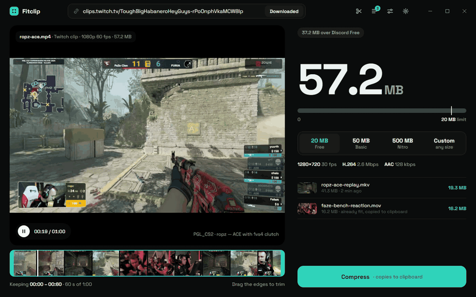
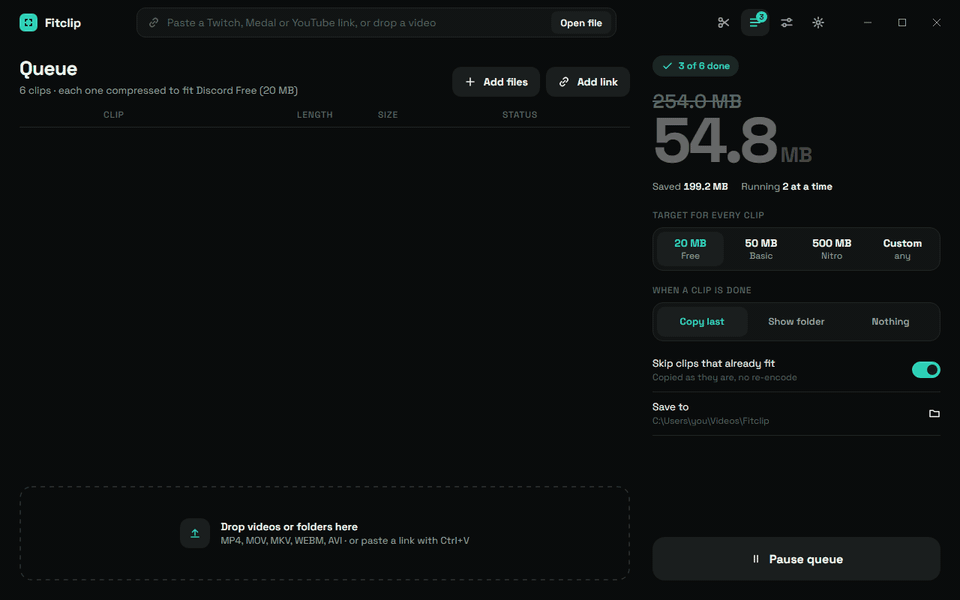
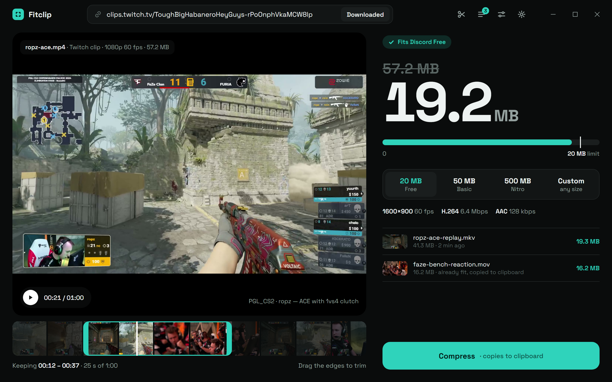
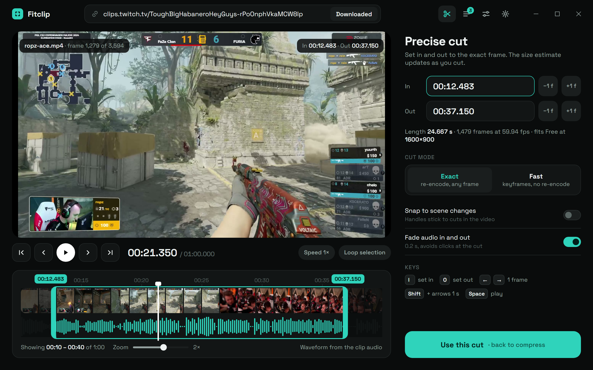
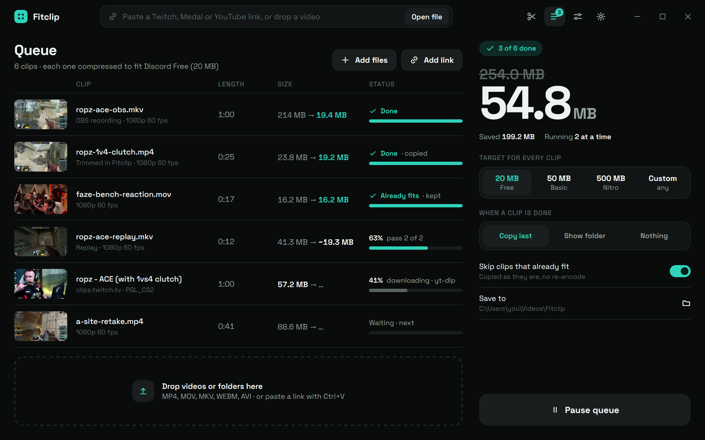
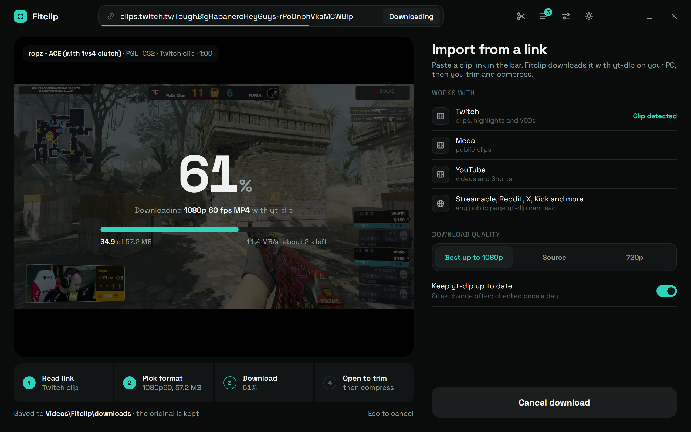
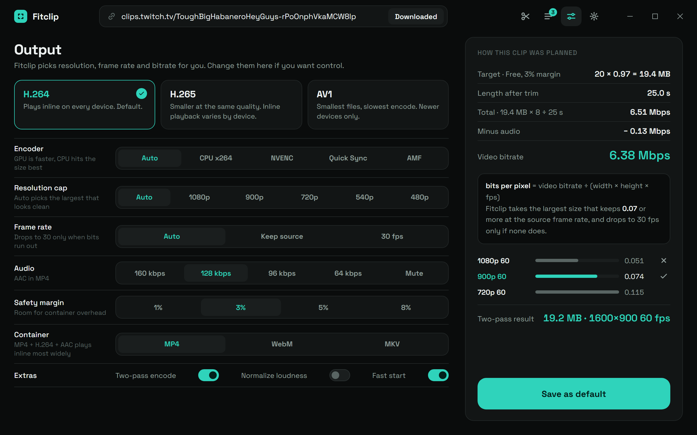
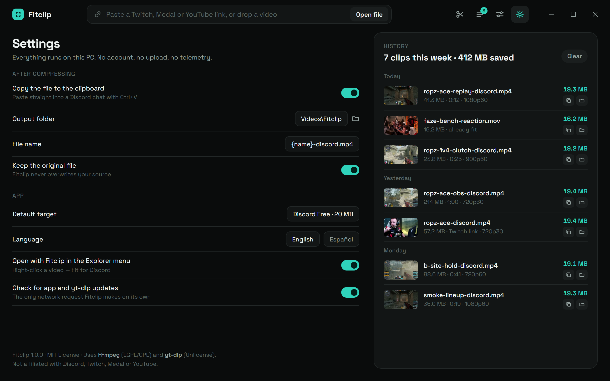
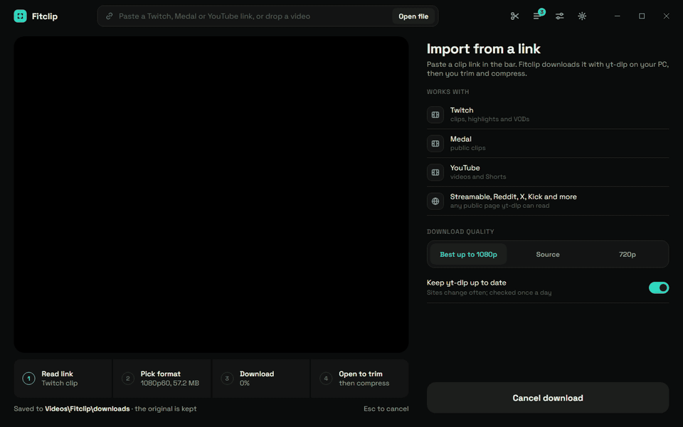

<div align="center">

<a href="https://github.com/DirectorEliminate/fitclip/releases/latest">
  
</a>

<h1>Fitclip — 免费 Discord 视频压缩工具，支持 Windows、macOS 和 Linux</h1>

<p>
Fitclip 是一款免费开源的 Discord 视频压缩工具，支持 Windows、macOS 和 Linux，在你自己的电脑上裁剪并压缩任意视频或 Twitch 剪辑，让它符合 Discord 的上传限制：免费用户 20 MB，Nitro Basic 50 MB，Nitro 500 MB。<br>
<b>原文件 57.2 MB，压缩后 19.2 MB。</b>拖入文件，或粘贴 <b>Twitch 剪辑</b>、Medal 或 YouTube 链接，拖动手柄裁剪，点击“压缩”，再把结果粘贴到 Discord 即可。<br>
无需上传，无水印，无需注册账号，不限文件大小。
</p>

<p>
<a href="https://github.com/DirectorEliminate/fitclip/releases/latest"></a>
<a href="https://github.com/DirectorEliminate/fitclip/releases"></a>
<a href="https://github.com/DirectorEliminate/fitclip/stargazers"></a>
<a href="LICENSE"></a>

<a href="https://github.com/DISCORD_INVITE"></a>
</p>

<p>
<a href="https://github.com/DirectorEliminate/fitclip/releases/latest/download/fitclip.zip"></a>
<a href="https://github.com/DirectorEliminate/fitclip/releases/latest/download/fitclip.zip"></a>
<a href="https://github.com/DirectorEliminate/fitclip/releases/latest/download/fitclip.zip"></a>
</p>

<p>
<a href="README.md">English</a> · <a href="README.es.md">Español</a> · <a href="README.ar.md">العربية</a> · <a href="README.hi.md">हिन्दी</a> · <b>简体中文</b> &nbsp;|&nbsp;
<a href="https://github.com/DirectorEliminate/fitclip/releases/latest">发布版本</a> ·
<a href="#how-fitclip-picks-the-bitrate">计算原理</a> ·
<a href="#features">功能</a> ·
<a href="#download">下载</a> ·
<a href="#faq">常见问题</a>
</p>



</div>

<table>
<tr><th></th><th align="left">处理前</th><th align="left">经 Fitclip 处理后</th></tr>
<tr><td><b>文件</b></td><td><code>ropz-ace.mp4</code>，一段 Twitch 剪辑</td><td><code>ropz-ace-discord.mp4</code>，已复制到剪贴板</td></tr>
<tr><td><b>大小</b></td><td>57.2 MB</td><td><b>19.2 MB</b></td></tr>
<tr><td><b>时长</b></td><td>1:00</td><td>0:25，只保留 1v4 残局</td></tr>
<tr><td><b>视频</b></td><td>1920×1080，60 fps，7.9 Mbps H.264</td><td>1600×900，60 fps，6.4 Mbps H.264</td></tr>
<tr><td><b>音频</b></td><td>AAC 128 kbps</td><td>AAC 128 kbps</td></tr>
<tr><td><b>Discord 免费版（20 MB）</b></td><td>太大，发不出去</td><td>可以发送，还剩 0.8 MB 余量</td></tr>
</table>

## 概览

| | |
|---|---|
| **是什么** | 一款桌面应用，裁剪并压缩视频，让它符合 Discord 的单文件上传限制 |
| **价格与许可** | 免费，基于 MIT 许可证开源。无水印、无广告、无需账号、没有付费版 |
| **平台** | Windows 10 / 11（x64）、macOS 12+（Apple Silicon 和 Intel）、Linux（x64，AppImage 和 .deb） |
| **离线可用** | 是。压缩通过 FFmpeg 在本地完成，你的视频绝不会被上传；唯一的联网行为是下载你粘贴的链接，以及每天一次的更新检查（可关闭） |
| **Discord 预设** | 20 MB 免费版、50 MB Nitro Basic、500 MB Nitro，或任意自定义大小（限制为撰写本文时的数据，2026 年 11 月） |
| **主要功能** | 两遍编码，目标比限制低 3% · 自动选择分辨率和帧率 · 缩略图裁剪条和逐帧精确剪切 · 支持 Twitch、Medal 和 YouTube 链接 · 结果自动复制到剪贴板 · 批量队列 · H.264、H.265、AV1 |
| **内置工具** | FFmpeg（LGPL/GPL）和 yt-dlp（Unlicense）；无需另外安装任何东西 |
| **可替代** | 各类在线视频压缩网站；如果你只是想“把它压到 X MB 以内”，也可以替代 HandBrake |
| **版本** | 1.0.0 |

## 放进一个链接，拿到一个文件

<table>
<tr>
<td width="31%" valign="top"><b>1 · 导入视频</b><br>把文件拖到窗口上，复制链接后按 <kbd>Ctrl</kbd>+<kbd>V</kbd>，或在资源管理器中右键点击视频 → <i>适配 Discord</i>。链接由 <a href="https://github.com/yt-dlp/yt-dlp">yt-dlp</a> 在你的电脑上下载。</td>
<td width="3%" align="center">→</td>
<td width="31%" valign="top"><b>2 · 留下精彩部分</b><br>拖动缩略图条上的青绿色手柄。拖动时，预计大小和画质会实时更新，因为剪辑越短，每秒能分到的码率就越高。</td>
<td width="3%" align="center">→</td>
<td width="31%" valign="top"><b>3 · 压缩并粘贴</b><br>选择 <i>20 MB 免费版</i>、<i>50 MB Basic</i>、<i>500 MB Nitro</i> 或自定义大小。Fitclip 进行两遍编码，把文件复制到剪贴板，你直接粘贴到 Discord 聊天里即可。</td>
</tr>
</table>

<a id="how-fitclip-picks-the-bitrate"></a>
## Fitclip 如何确定码率

文件大小等于码率乘以时长。所以 Fitclip 不让你去猜画质滑块，而是从你需要的文件大小倒推：

```text
target size   = upload limit × (1 − safety margin)            margin = 3 % for container overhead
total bitrate = target size × 8 ÷ length in seconds
video bitrate = total bitrate − audio bitrate
bits/pixel    = video bitrate ÷ (width × height × fps)          keep it ≥ 0.07 for clean game footage
```

然后，它会在源帧率下选择每像素比特数仍不低于 0.07 的**最高分辨率**（1080p → 900p → 720p）。如果都达不到，就把帧率减半再试一次，再依次降到 540p、480p 和 360p。编码采用**两遍编码**：第一遍分析每个场景的复杂程度，第二遍把码率花在动作激烈的地方，最终大小刚好落在目标以下，而不会超出。

**实例：截图中的这段剪辑**（这里的 MB 指 1,048,576 字节，与 Windows 和 Discord 显示文件大小的方式一致）

| 步骤 | 计算 | 结果 |
|---|---|---|
| 目标大小 | 20 MB × 0.97 | **19.4 MB** = 20,342,374 字节 |
| 裁剪后时长 | 00:12 → 00:37 | **25.0 s** |
| 总码率 | 20,342,374 × 8 ÷ 25 | **6.51 Mbps** |
| 视频码率 | 6.51 − 0.128（AAC） | **6.38 Mbps** |
| 1080p，59.94 fps | 6,381,560 ÷ (1920 × 1080 × 59.94) | 0.051 ✗ 比特不够 |
| **900p，59.94 fps** | 6,381,560 ÷ (1600 × 900 × 59.94) | **0.074 ✓ 选中** |
| 两遍 H.264 编码结果 | | **19.2 MB**，1600×900，60 fps |

同一段剪辑如果**不裁剪**（60 s），视频码率只有 2.59 Mbps：720p 60 fps 只能达到 0.047，所以 Fitclip 保持 720p 并降到 30 fps（0.094）。只留下关键时刻，是提升画质最省事的办法。输出界面会为每个文件显示这套方案，一切都清清楚楚，没有黑箱。

<a id="features"></a>
## 功能

<table>
<tr>
<td width="33%" valign="top"><b>🎯 精准命中大小</b><br>两遍编码，目标比限制低 3%。不用反复“降低画质再试一次”。</td>
<td width="33%" valign="top"><b>✂️ 按真实画面裁剪</b><br>带青绿色手柄的缩略图条，外加精确剪切界面，支持逐帧步进并显示音频波形。</td>
<td width="33%" valign="top"><b>🔗 剪辑链接</b><br>粘贴 Twitch、Medal 或 YouTube 链接。yt-dlp 在本地下载，下载完即可直接裁剪。</td>
</tr>
<tr>
<td valign="top"><b>📋 自动复制到剪贴板</b><br>压缩好的文件已经在剪贴板里。在 Discord 中按 <kbd>Ctrl</kbd>+<kbd>V</kbd> 就能上传。</td>
<td valign="top"><b>🧮 自动分辨率和帧率</b><br>根据上面的计算，自动选择 1080p、900p 或 720p 以及 60 或 30 fps。所有参数都能在“输出”界面手动修改。</td>
<td valign="top"><b>📦 批量队列</b><br>拖入一整个剪辑文件夹。每个文件都压到同一目标大小；已经符合限制的文件会被跳过，保持原样。</td>
</tr>
<tr>
<td valign="top"><b>🎞️ H.264、H.265、AV1</b><br>默认使用 H.264，任何地方都能直接内嵌播放；H.265 和 AV1 文件更小。可用时会调用 GPU 编码器。</td>
<td valign="top"><b>🔒 离线且私密</b><br>你的视频永远不会离开你的电脑。无需账号，无遥测，无水印，不限文件大小。</td>
<td valign="top"><b>🖱️ 随处拖放</b><br>拖到窗口上、拖进队列，或在资源管理器中右键 → <i>适配 Discord</i>。</td>
</tr>
</table>

<p align="center">

</p>

## 界面截图

| | |
|---|---|
| <br><sub><b>压缩。</b>原始大小划掉显示，结果大小，对照限制的指示条，方案选择器。</sub> | <br><sub><b>精确剪切。</b>入点和出点精确到帧，可选精确剪切或关键帧剪切，支持音频淡入淡出。</sub> |
| <br><sub><b>队列。</b>多段剪辑，同一目标，每次同时处理两个。</sub> | <br><sub><b>链接导入。</b>yt-dlp 在你的电脑上下载剪辑。</sub> |
| <br><sub><b>输出。</b>编码格式、编码器、各项上限，以及这段剪辑的压缩方案。</sub> | <br><sub><b>设置和历史记录。</b>每段压缩过的剪辑都在这里，随时可以再次复制。</sub> |

## 支持的来源



| 来源 | 支持内容 | 导入方式 |
|---|---|---|
| **视频文件** | MP4、MOV、MKV、WEBM、AVI、M4V、FLV、TS，以及 FFmpeg 能读取的其他任何格式 | 拖放、*打开文件*、资源管理器右键菜单、粘贴文件 |
| **游戏录像** | OBS、NVIDIA ShadowPlay / NVIDIA App、Xbox Game Bar、AMD ReLive、Steam 游戏录制导出的文件 | 把文件或整个文件夹拖进队列 |
| **Twitch** | 公开的剪辑、精彩片段和 VOD | 粘贴链接，由 yt-dlp 下载 |
| **Medal** | 公开剪辑 | 粘贴链接 |
| **YouTube** | 视频和 Shorts | 粘贴链接 |
| **其他网站** | Streamable、Reddit、X、Kick 以及 yt-dlp 支持的其他公开网站 | 粘贴链接 |

只下载你自己制作或已获授权使用的视频。不支持私密视频、仅限订阅者观看的视频和受 DRM 保护的视频。

## Discord 上传限制

Fitclip 的预设遵循 Discord 公布的单文件限制。**以下为撰写本文时（2026 年 11 月）的数据：**

| 上传者 | 单文件限制 | Fitclip 预设 |
|---|---|---|
| 免费账号 | **20 MB**（2026 年 8 月 13 日从 10 MB 上调） | **20 MB 免费版** |
| Nitro Basic | 50 MB | 50 MB Basic |
| Nitro | 500 MB | 500 MB Nitro |
| 在 Boost 等级 2 服务器中的任何人 | 在该服务器中 50 MB | 自定义 → 50 MB |
| 在 Boost 等级 3 服务器中的任何人 | 在该服务器中 100 MB | 自定义 → 100 MB |

Discord 已经多次调整这些数值（8 MB → 25 MB → 10 MB → 20 MB）。预设保存在一个随应用更新的小文件里，而**自定义**可以输入任意大小，包括 10 MB，方便你仍需旧限制或要发到别的地方时使用。

## Fitclip 与在线视频压缩工具对比

在线压缩工具用起来方便，但你的视频得先上传到别人的服务器上。以下是一份公平的对比，**以撰写本文时为准**（免费版的规则因网站而异且经常变化，使用前请自行确认）：

| | **Fitclip** | 典型的免费在线压缩工具 | HandBrake |
|---|:---:|:---:|:---:|
| 价格 | 免费，MIT | 免费版 + 付费套餐 | 免费，GPL |
| 视频需要上传 | **不需要，留在你的电脑上** | 需要 | 不需要 |
| 水印 | **从不** | 部分免费版有 | 从不 |
| 输入文件大小上限 | **无** | 免费版通常有上限 | 无 |
| “压到 X MB” 目标大小 | **支持，两遍编码** | 通常支持 | 只能设平均码率，需要自己计算 |
| Discord 预设（20 / 50 / 500 MB） | **有** | 部分有 | 无 |
| 压缩前裁剪 | **支持** | 部分支持 | 支持 |
| 从 Twitch / Medal / YouTube 链接下载 | **支持（yt-dlp）** | 很少 | 不支持 |
| 结果复制到剪贴板 | **支持** | 不支持 | 不支持 |
| 离线可用 | **是** | 否 | 是 |

如果你在找一款不会上传你剪辑的**在线 Discord 压缩工具的免费替代品**，这正是 Fitclip 的初衷。

<a id="download"></a>
## 下载

| 平台 | 安装包 | 说明 |
|---|---|---|
| **Windows 10 / 11**（x64） | [`fitclip.zip`](https://github.com/DirectorEliminate/fitclip/releases/latest/download/fitclip.zip) · [便携版 `.zip`](https://github.com/DirectorEliminate/fitclip/releases/latest/download/fitclip.zip) | `winget install Fitclip.Fitclip` · `scoop install fitclip` |
| **macOS 12+**（Apple Silicon 和 Intel） | [`Fitclip-1.0.0-universal.dmg`](https://github.com/DirectorEliminate/fitclip/releases/latest/download/fitclip.zip) | `brew install --cask fitclip` |
| **Linux**（x64） | [`AppImage`](https://github.com/DirectorEliminate/fitclip/releases/latest/download/fitclip.zip) · [`.deb`](https://github.com/DirectorEliminate/fitclip/releases/latest/download/fitclip.zip) | Flathub：`io.github.DirectorEliminate.Fitclip` |

已内置 FFmpeg 和 yt-dlp，无需另外安装任何东西。**系统要求：**64 位操作系统，4 GB 内存，约 250 MB 磁盘空间。支持 NVIDIA NVENC、Intel Quick Sync、AMD AMF 或 Apple VideoToolbox 的 GPU 可以加快编码速度，但不是必需的。每个发布版本都附带校验文件 `SHA256SUMS.txt`。

## 使用场景

- **在 Discord 上发 Twitch 剪辑。** 粘贴 `clips.twitch.tv` 链接，裁剪、压缩、粘贴。截图中的剪辑从 57.2 MB 压到了 19.2 MB。
- **把 OBS 录像压到能发 Discord 的大小。** 1 分钟的 1080p60 录像通常有 150–250 MB。Fitclip 会裁剪并把它压进 20 MB，有 Nitro Basic 的话可以是 50 MB。
- **把手机视频压小发到 Discord。** iPhone 的 `.mov` 文件（HEVC）会转换成 H.264 MP4，所有人都能直接在聊天里播放。
- **批量压缩 Discord 视频。** 发比赛回顾之前，把整个精彩集锦文件夹拖进队列即可。
- **Nitro 用户。** 选择 50 MB 或 500 MB，同一段剪辑能保留更高画质，不必像免费版那样硬压。

<a id="faq"></a>
## 常见问题

<details>
<summary><b>怎么压缩视频发到 Discord？</b></summary>

打开 Fitclip，把视频拖到窗口上（或粘贴链接），拖动手柄留下想要的部分，方案保持 **20 MB 免费版**（或选择你的 Nitro 方案），然后点击**压缩**。压缩好的 MP4 会复制到剪贴板；点一下 Discord 的消息输入框，按 <kbd>Ctrl</kbd>+<kbd>V</kbd> 即可。
</details>

<details>
<summary><b>Discord 文件大小限制是多少？还是 10 MB 吗？</b></summary>

不是。在撰写本文时，免费账号可以上传最大 **20 MB** 的文件。Discord 在 2024 年把免费限制从 25 MB 降到 10 MB，又在 2026 年 8 月 13 日上调到 20 MB。Nitro Basic 允许 50 MB，Nitro 允许 500 MB；Boost 等级 2 和 3 的服务器分别允许其中所有成员上传 50 MB 和 100 MB。如果你出于某种原因仍需要旧的 **Discord 10 MB** 大小，选择*自定义*并输入 10 即可。
</details>

<details>
<summary><b>怎样压缩视频又不损失画质？</b></summary>

文件变小很多时，画质损失在所难免，但你可以让它几乎看不出来：**先裁剪**（时长减半，码率就翻倍），让 Fitclip 自动选择分辨率，确保每个像素分到足够的比特，保持两遍编码开启；如果朋友的设备能播放，还可以用 H.265 或 AV1。以上面的剪辑为例，25 s、900p60、6.4 Mbps 的效果和 7.9 Mbps 的 1080p60 原片非常接近。
</details>

<details>
<summary><b>怎么把 Twitch 剪辑发到 Discord？</b></summary>

把 `clips.twitch.tv/...` 链接粘贴到 Fitclip 顶部栏：yt-dlp 会下载 1080p 版本，你裁剪一下，Fitclip 把它压到合适大小，然后你把文件粘贴到 Discord。只发链接也行，但那样大家就得去 Twitch 上看。请只对你有权分享的剪辑这样做。
</details>

<details>
<summary><b>视频最长多长还能压进 20 MB？</b></summary>

对于游戏画面，大约 25–30 s 可以保持 1080p 或 900p 60 fps，大约 1 分钟可以做到 720p 30 fps，而大约 5 分钟是 360p 下仍能保持清晰的最长时长。超过这个长度，Fitclip 会提醒你，并建议裁剪或换更大的方案。
</details>

<details>
<summary><b>为什么文件比限制略小，而不是正好 20 MB？</b></summary>

Fitclip 的目标比限制低 3%，给 MP4 容器和码率控制的小误差留出空间。超出 0.1 MB 的文件会被 Discord 拒绝，而小 0.6 MB 的不会。你可以在“输出”界面把余量设为 1%。
</details>

<details>
<summary><b>Fitclip 会把我的视频上传到任何地方吗？</b></summary>

不会。压缩通过 FFmpeg 在本地完成。唯一的网络请求是你粘贴链接后发起的下载，以及每天一次的应用和 yt-dlp 更新检查，后者可以关闭。
</details>

<details>
<summary><b>为什么我的 H.265 或 AV1 视频在 Discord 里不能直接播放？</b></summary>

能否内嵌播放取决于观看者的设备和应用。MP4 封装的 H.264 + AAC 是最稳妥的选择，所以它是默认设置。当你知道谁会观看，或者文件体积比内嵌预览更重要时，再使用 H.265 或 AV1。
</details>

<details>
<summary><b>可以一次压缩多个视频吗？</b></summary>

可以。打开队列，拖入文件或文件夹，为它们统一选择一个目标大小，Fitclip 每次同时处理两个。已经符合限制的剪辑会原样复制，不会重新编码。
</details>

<details>
<summary><b>Fitclip 免费吗？有水印吗？</b></summary>

免费，基于 MIT 许可证开源，没有水印。无广告、无需账号、没有付费版。它内置了 FFmpeg（LGPL/GPL）和 yt-dlp（Unlicense），详见下方致谢。
</details>

<details>
<summary><b>Fitclip 是 Discord 或 Twitch 官方出品的吗？</b></summary>

不是。这是一个独立的开源项目，与 Discord、Twitch、Medal 或 YouTube 均无关联。
</details>

## 路线图

- [x] 压到 20 / 50 / 500 MB 或任意自定义大小，两遍编码
- [x] 缩略图裁剪条和逐帧精确剪切界面
- [x] 通过 yt-dlp 支持 Twitch、Medal 和 YouTube 链接
- [x] 批量队列，跳过已符合限制的文件
- [x] H.264、H.265、AV1 和 GPU 编码器
- [ ] 裁切为 9:16，适配 Shorts 和手机
- [ ] 监视文件夹：自动压缩每一段新的 OBS 回放
- [ ] 输出 GIF 和动态 WebP，用作表情反应
- [ ] 压缩前把多段剪辑合并成一段
- [ ] 从 `.srt` 文件烧录硬字幕
- [ ] 更多语言（葡萄牙语、德语、法语）

想法和投票：[Discussions](https://github.com/DirectorEliminate/fitclip/discussions/categories/ideas)。

## 技术栈

<p>


</p>

**致谢。** 视频处理由 [FFmpeg](https://ffmpeg.org/) 完成（LGPL 2.1+，内置版本包含 x264/x265 等 GPL 组件；源代码和许可证文本随每个发布版本一起提供）。链接下载由 [yt-dlp](https://github.com/yt-dlp/yt-dlp) 完成（Unlicense）。感谢这两个项目。

## 参与贡献

欢迎提交 Bug 报告、预设、翻译和代码。请阅读 [CONTRIBUTING.md](CONTRIBUTING.md)；安全问题请参阅 [SECURITY.md](SECURITY.md)。

<a href="https://github.com/DirectorEliminate/fitclip/graphs/contributors"></a>

<a href="https://star-history.com/#DirectorEliminate/fitclip&Date">
  
</a>

## 许可证与免责声明

Fitclip 基于 [MIT 许可证](LICENSE) 发布。内置的 FFmpeg 和 yt-dlp 沿用各自的许可证。

Fitclip 是一个独立项目，**与 Discord Inc.、Twitch Interactive, Inc.、Medal 或 Google LLC（YouTube）均无关联，也未获得其认可或赞助**。Discord、Nitro、Twitch、Medal 和 YouTube 是其各自所有者的商标，此处提及仅用于说明兼容性。截图和 GIF 中的剪辑来自 PGL_CS2 Twitch 频道的一场 PGL CS2 Major 直播（Counter-Strike 2 是 Valve 旗下的游戏），仅用于演示本应用。请只下载和分享你有权使用的视频。

---

<div align="center">

如果 Fitclip 帮你躲过了一次“文件过大”的提示，请 ⭐ **给仓库点个星**，让更多人找到它。

<sub>关键词：Discord 视频压缩 · 视频压缩 · 压缩视频发 Discord · Discord 10MB 和 20MB 限制 · 视频压缩到 20MB · Twitch 剪辑发到 Discord · 减小视频文件大小 · 免费开源视频压缩工具 · 无水印视频压缩 · 离线视频压缩软件 Windows、macOS 和 Linux · discord video compressor</sub>

</div>
